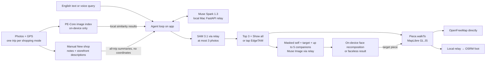

# Repository Guidelines

## Project Overview

**Street Fitting** is a Meta hackathon Android app. While shopping, users take photos and the app records their location. Later, they can find a garment with an English text or voice query, pick it from a photo, dress a virtual mannequin (outer, top, bottom) and try the whole outfit on in one image, and walk back to where a shop piece was photographed (`docs/prd/decisions.md`, D-R3-05, D-R5-01, D-R13-02).

Current state (nothing real is wired yet):
- `prototype/`: a clickable UI/UX demo with fixed data and timers. It has no camera, GPS, model, server, or map.
- `app/`: the real app shell. It has the Astryx theme and the Capacitor Android project, but `app/src/App.tsx` returns `null`.
- The hackathon deadline is **2026-11-04 21:00 EST / 11-05 11:00 KST**. Judging weights: Impact 30%, Meta AI use 25%, Technical depth 20%, Demo 25% (`hackathon-info.md`).
- Submission: a 3-minute demo video plus a public GitHub repository, entered solo in the **Indie Developer** track under the problem statement **Build for Your World**. No deployment: no APK release and no cloud relay. The video is recorded on the emulator against the local-Mac relay with live APIs (D-R8-01~03; `hackathon-info.md`).

### Source-of-truth docs (Korean prose; app UI copy is English)

| Doc | Use for |
| --- | --- |
| `street-fitting-research.md` §9 | **Confirmed MVP scope (Nov 3)**: P0/P1/excluded items, models, data boundary, limits; superseded where `docs/prd/decisions.md` says so |
| `street-fitting-research.md` §10 | Open validation items and their fallbacks |
| `docs/prd/` | Start at `docs/prd/README.md`; `decisions.md` records interview decisions, and `ux/`, `contracts/`, `product/` hold screen specs, contracts, and product rules |
| `prompts/street-fitting-mvp.md` | Original idea only; its premises (video, all inference on-device) are **superseded** |
| `hackathon-info.md`, `hackathon-research.md` | Event logistics and judging; reference only |
| `.scrapped/`, `my-info.md` | Abandoned, unrelated plans and personal background. Ignore unless asked |

### Product constraints (source: `docs/prd/decisions.md`, through R13)
- **Meta-provided models only.** This is a product rule; the event rules do not require it (D-R0-02).
  - Server APIs, via the relay: Muse Spark 1.3 (tool-calling search, storefront descriptions, wardrobe cutout labels), SAM 3.1 (garment candidates), Muse Image (try-on), Muse Voice Transcribe (**P0**, Find it input only; D-R3-05, D-R4-06, D-R7-09).
  - On-device ONNX: EdgeTAM (tap → 3 masks, automatic head masking) and the PE-Core-T16 image tower (photo index). The PE-Core text tower runs on the relay. Automatic head-mask accuracy is unverified (D-R7-01).
- **Privacy boundary:** only a face- and hair-removed self photo leaves the device. Masking is automatic, with no transmission-preview screen. Failure blocks upload; face recomposition happens on-device, with a faceless result if quality is insufficient (D-R4-03, D-R4-04, D-R4-11).
  - Device-only data: original self photos, raw location trails, photo embeddings, wardrobe originals, and recomposited results. Selected shop photos may go to SAM; storefront photos and wardrobe cutouts go to Spark; garment cutouts go to Muse Image. Visit summaries include shop notes (D-R3-04, D-R4-06).
  - The relay holds API keys and does not persist image, audio, or coordinate payloads. Logs contain metadata only by default; a local-development flag may additionally log query text and Spark response bodies, never images, audio, or coordinates (D-R6-04).
  - Never describe the design as "all on-device", "no photos to any server", or guaranteed provider zero retention.
- Fixed functional limits: ≤4 Spark calls and ≤3 SAM photos per query; ≤4 try-on images (1 masked self + 1–3 garments, one per mannequin slot: outer, top, bottom; D-R13-02). The relay enforces search limits; there are no user/team quotas, cost caps, or Firestore quota ledger (D-R3-01, D-R4-07, D-R6-02).
- Candidates are score-sorted: show the top 3 first, then expand with "Show all". **Never use PE-Core as a candidate filter** (D-R3-02).
- Each shopping-mode start creates a trip. All trips are searchable/browsable; home shows the latest trip and "All trips". Provide trip, photo, saved-piece, wardrobe-piece, and result deletion. Deleting a trip preserves saved cutouts and `Piece.walkTo`, but removes original-photo links (D-R3-03, D-R3-10, D-R3-11).
- Try-on is a mannequin: fill the outer, top, and bottom slots (one piece each, at least one, any origin), then **Fit** renders the whole outfit as one image. `Piece.category` is `outer|top|bottom|other|unknown`. Empty top/bottom keep what the person wears; an empty outer removes a photo jacket only when a top is chosen (D-R13-01~04). Pieces come from the wardrobe, saved pieces, or cutouts made directly from trip photos. Keep one replaceable self photo. Result download is feature-flagged OFF until watermark/metadata preservation is verified; no Look/Original comparison or regenerate action (D-R4-01~10).
- Walk to `Piece.walkTo`, not `Shop.spot`; a result offers one walk-back per shop among its shop pieces (D-R13-05). Pins cannot be moved. All distances remain in-app, with direction/distance for the final or unmapped segment (D-R5-01~05).
- The relay is Python/FastAPI on the local Mac only. OpenAPI generates app TS types. Firebase anonymous auth + App Check use development credentials/debug provider; no dev badge. Emulator integration runs mock once and live once, using Codex-generated demo images and a debug-only adb-enabled camera fixture. No physical-device demo is required (D-R6-01, D-R6-05, D-R7-02, D-R7-05~10).
- Excluded: video recording, location recording outside shopping mode, automatic shop splitting, shop-photo gallery import, Korean UI/queries, wardrobe similarity matching, real glasses **and DAT Mock**, voice/background/indoor navigation, and public release (D-R0-02, D-R0-03, D-R2-03, D-R2-06, D-R2-09; research §9).

## Architecture & Data Flow

Planned pipeline (`docs/prd/decisions.md`, D-R1-02, D-R3-03~07, D-R4-03~09, D-R5-01~05, D-R6-05, D-R7-02~03). Today only `prototype/` simulates it.



### `prototype/` (React 18, Vite 6)
- Render tree: `src/main.tsx` → `App.tsx` → `StoreProvider` → `NavProvider` → kit `Stage` → `Phone(frame="android")` → `Screens` → `Layer` → `Route` switch. **Reset** remounts the providers.
- Navigation (`src/state.tsx`): one stack that starts at `home`, with no bottom tabs.
  - Routes are a discriminated union, `Route`. `useNav()` exposes `push`, `pop`, and `popTo(name, then?)`.
  - A leaving screen is kept for `SLIDE_MS` (360 ms) so it can animate out. `Esc` goes back.
- Session state (`src/state.tsx`): plain context with `useState`/`useMemo`, no reducer. `useStore()` exposes `shopping`, `saved`/`save`, `wardrobe`/`addToWardrobe`, `outfit`/`setOutfit` (max 9), `results`/`addResult`, and the toast `say`/`hush`. Everything is in memory; nothing persists.
- Data (`src/data.ts`): the `Box` type is a percent-of-photo tuple. Other types: `Candidate`, `Photo`, `Shop`, `Piece` (the shared unit for try-on and navigation). Fixed lookups (`photo`, `shop`, `photosOf`, `pieceFrom`) rely on non-null assertions.
- Fake pipelines run on timers:
  - Capture cycles through `CAMERA_ROLL`.
  - `Ask` uses a keyword `answer()`.
  - `Pick` uses preset boxes or 3 boxes around the tap point.
  - `TryOn` places crops over a silhouette and steps through send → generate → restore.
  - `Walk` uses a fixed SVG route plus a `Demo` stepper.

### `app/` (React 19, Vite 8, TS 7, Capacitor 8)
- `src/main.tsx` imports `@astryxdesign/core/reset.css`, `astryx.css`, and `@fontsource-variable/outfit`, then renders `<Theme theme={themes[defaultThemeSlug]} mode="light">`.
- Theme source: `src/themes/hanok-indigo/hanokIndigoTheme.ts`. It extends `neutralTheme` with the Hanok palette, an indigo accent, ink-colored primary buttons, light mode only, flat/matte styling, and local tokens `--color-hero`, `--color-ink`, `--color-hanok-*`, `--pattern-eave`.
- Android: Capacitor copies `dist/` into `android/` (`webDir: dist`, `appId: com.streetfitting.app`). `MainActivity.java` extends `BridgeActivity`.
- The manifest declares only `INTERNET`. Camera, location, and foreground-service location permissions (`FOREGROUND_SERVICE_LOCATION`, per research §9) are still to be added.

## Key Directories

| Path | Purpose |
| --- | --- |
| `prototype/src/screens/` | One file per flow; a file may export several screens (`TryOn.tsx` → `Outfit`, `Send`, `Result`, `Results`; `Trip.tsx` → `Trip`, `Visit`) |
| `prototype/src/ui.tsx` | Shared prototype parts: `TopBar`, `Screen`, `Section`, `Sheet`, `Shot` (candidate boxes), `Crop`, `PieceTile`, `Storefront`, `Thumb`, `I` (icons) |
| `prototype/src/kit/` | **Vendored** stageshow kit (MIT, `kit/LICENSE`). Import it via `./kit` and don't modify it |
| `prototype/public/photos/` | Sample photos; licenses are in `CREDITS.md` |
| `app/src/themes/hanok-indigo/` | Theme source (`hanokIndigoTheme.ts`) plus generated `hanok-indigo.{js,css,d.ts,variants.d.ts,css.d.ts}` |
| `app/android/` | Capacitor Android project (Gradle, Java) |

## Development Commands

Each subproject is a separate npm project. Run commands inside it; there is no root workspace.

```sh
# app/
npm run dev                      # Vite dev server
npm run lint                     # oxlint
npm run build                    # tsc -b && vite build → dist/
npx astryx doctor --built dist   # required before delivering an app build
npx astryx theme build src/themes/hanok-indigo/hanokIndigoTheme.ts   # after editing theme source
npm run build && npx cap sync android && npx cap open android        # Android (not yet exercised)
cd android && ./gradlew assembleDebug                                # CLI debug APK (shell build exercised)

# prototype/
npm run dev                      # http://127.0.0.1:5180
npm run build                    # tsc --noEmit && vite build
```

Last observed (2026-11-04):
- `app`: lint exits 0 with one warning, `triple-slash-reference` in the generated `hanok-indigo.d.ts`. Build passes.
- `doctor` exits 0 with a `theme-fonts` warning. The font is imported in `main.tsx` instead.
- `prototype`: build passes.
- Readiness smoke on the M1: `cap sync android` and `assembleDebug` pass; the shell APK installs and starts. `Medium_Phone`, API 37.0 Play Store 16 KB ARM64 revision 8, reports `PAGE_SIZE=16384`. Playwright-Android attaches to `com.streetfitting.app`; host WebGL works. The blank app shell is expected, not evidence of product functionality.
- Emulator 37.2.13 raises configured 2048 MB RAM to 4096 MB at startup. Keep one emulator and serialize device checks. GPS console, UI hierarchy dump, 3-second console recording, and mono 16 kHz PCM16 speech-file generation were exercised.
- Codex 0.166.0 noninteractive built-in image generation saved a real PNG. This is tool readiness only, not the S11 fixture corpus.

## Code Conventions & Common Patterns

- **Styles differ per subproject.** There is no Prettier or other formatter, so match the file you are editing.
  - `app/`: semicolons, single quotes, `import {X} from` (no spaces inside braces).
  - `prototype/`: no semicolons, single quotes, `import { X } from`.
- **`app/` follows the Astryx rules** in `app/AGENTS.md`:
  - Start from `npx astryx build "<idea>"` / `astryx template`.
  - **No raw `<div>`.** Use component props, then tokens (`var(--color-*)`, `--spacing-*`, `--radius-*`). No raw hex or px.
  - Palette changes go through the theme, not `:root` overrides.
- `app/` TypeScript flags: `verbatimModuleSyntax` (use `import type`), `erasableSyntaxOnly` (no `enum`, `namespace`, or parameter properties), `noUnusedLocals`/`noUnusedParameters`, `allowImportingTsExtensions` (`import App from './App.tsx'`).
- `app/` oxlint: `react/rules-of-hooks` is an error; `react/only-export-components` is a warning.
- **`prototype/` does not use Astryx.** It uses `<div>`s with plain CSS in `src/app.css`:
  - Class prefixes `sf-*` (app) and `host__*` (page around the phone).
  - State goes in `data-*` attributes (`data-pos`, `data-fresh`).
  - Theme colors are hand-mapped to stageshow `--ss-*` tokens in `src/look.css`. They are not shared with `app/` automatically, so mirror theme changes manually.
- To add a prototype screen:
  1. Add a variant to `Route` and an entry to `TITLES` (a `Record<Route['name'], string>`, so it stays exhaustive) in `state.tsx`.
  2. Add a `case` to the `Route` switch in `App.tsx`.
  3. Put the named-export component in `src/screens/`.
- Naming: screen and component files are PascalCase with named exports (only `App` is a default export); data, util, and style files are lowercase.
- Async: fake latency is `window.setTimeout` / `setInterval` inside `useEffect`, and the cleanup must be returned. No `fetch`, no `async`, and no error handling exist yet; missing items render `null`.
- UI copy is hardcoded English with no i18n. The PRD quotes screen copy verbatim, so when you change prototype flows or copy, update the matching `docs/prd/ux/*.md` file.
- Doc writing (Korean): mark inference as `[추론]` and unverified items as `미확인`. Keep "decided" and "to be verified" separate.

## Important Files

- `prototype/src/App.tsx`, `prototype/src/state.tsx`, `prototype/src/data.ts`: prototype routing, state, and fake data
- `app/src/main.tsx`, `app/src/App.tsx`: real app entry; the screens still need to be built
- `app/capacitor.config.ts`: appId, appName, webDir
- `app/android/app/build.gradle`, `app/android/variables.gradle`: SDK versions and dependencies
- `app/android/app/src/main/AndroidManifest.xml`: permissions
- `app/AGENTS.md`, `app/GEMINI.md`: generated Astryx guidance. Don't hand-edit inside the `<!-- ASTRYX:START/END -->` markers
- **Generated; do not edit:**
  - `app/src/astryx-themes.ts`, plus `app/src/themes/hanok-indigo/hanok-indigo.*`; regenerate them with `astryx theme`.
  - `app/android/capacitor.settings.gradle`, `app/android/app/capacitor.build.gradle`, and `app/android/capacitor-cordova-android-plugins/`; regenerate them with `cap sync/update`.

## Runtime/Tooling Preferences

- npm with `package-lock.json` (v3) in each subproject. Do not add other package managers.
- Node ≥ 22.13, required by the Astryx CLI (v24.20.0 observed).
- Android: AGP 8.13.0, Gradle wrapper 8.14.3, Java 21, minSdk 24, target/compileSdk 36, package `com.streetfitting.app`.
- `app/android/local.properties` is machine-specific and gitignored.
- Development and verification machine: **M1 Mac mini, 16 GB** (D-R10-03). Don't depend on chip-specific behavior (M4 or otherwise). Treat results observed on other Macs as unverified until they are reproduced on the M1. Tool and AVD setup is in `docs/prd/README.md` ("기준 기기 준비").
- Emulator verification uses Playwright-Android for the WebView and adb/emulator console for system UI, GPS, and recording. It must run on the Mac without Orca (D-R10-01).
- The native stack uses CameraX, FusedLocation, and ONNX Runtime in custom Capacitor Java plugins; React owns all UI, and MapLibre GL JS runs in the WebView. The Python/FastAPI relay runs on the local Mac only, with Firebase auth/App Check and no Firestore or Cloud Run. Native libraries must be 16 KB page-aligned (`docs/prd/decisions.md`, D-R6-01, D-R6-02, D-R6-05, D-R7-02, D-R7-03).
- Photo assets: when you add or replace a file in `prototype/public/photos/`, record its author, source, and license (CC0 / CC BY / CC BY-SA) in `CREDITS.md`.
- Browser tasks that need a login (the Cerebral Valley portal, Meta developer console/billing, Discord, Gmail, GitHub web, and similar) use the **Aside CLI** (`aside`; see `aside guide`), which reuses the user's signed-in browser sessions. Prefer `aside exec "<task>"`; use `aside repl` only when you need the DOM or screenshots directly. Never submit forms, post messages, change billing, or reveal secrets without the user's explicit instruction; report key values and card numbers as presence only. For public pages that need no login, use `read`/web search.

## Testing & QA

- No JS test framework, no CI, and no coverage targets exist. Android has only the template tests under `app/android/app/src/{test,androidTest}/java/com/getcapacitor/myapp/`.
- `ExampleInstrumentedTest` expects the package `com.getcapacitor.app`, but the real package is `com.streetfitting.app`. `[INFERENCE]` It will fail until it is fixed.
- Verification gates:
  - `app/`: `npm run lint && npm run build && npx astryx doctor --built dist`.
  - `prototype/`: `npm run build`, then click through the changed flow at `127.0.0.1:5180`.
  - Android: `./gradlew testDebugUnitTest`; `connectedDebugAndroidTest` needs a device or emulator.
- Research §10 is historical validation guidance, superseded by `docs/prd/decisions.md`: automatic shop splitting and DAT Mock are excluded; masking/recomposition quality, search/SAM accuracy, API latency, and watermark/metadata preservation remain unverified. Integration is emulator mock once and live once (D-R2-03, D-R2-06, D-R4-10, D-R7-01, D-R7-05).
