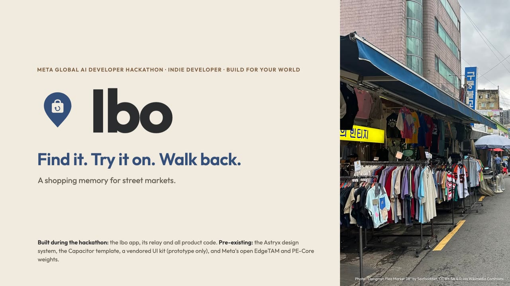
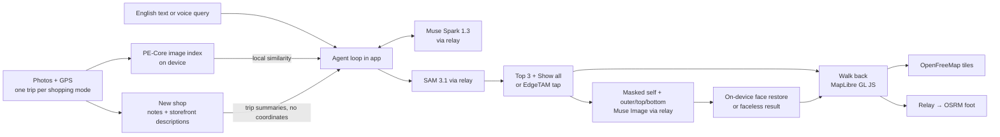

<p align="center"></p>

# Ibo: find it, try it on, walk back

<p align="center">
  <a href="https://youtu.be/4NLaaIOFXkc"></a>
  <br>
  <a href="https://youtu.be/4NLaaIOFXkc"><b>▶ Watch the demo video on YouTube (2:47)</b></a>
</p>

Ibo is an Android app for street-market clothes shopping. Snap photos while you browse and each one keeps the spot where you took it. Later you can find a garment by asking for it in plain English, cut it out of your photo, try it on with clothes you already own, and walk back to the stall where you saw it.

Built for the **Meta Global AI Developer Hackathon** (Indie Developer track, *Build for Your World*). The Android package name is `com.streetfitting.app`, from the project's working name *Street Fitting*.

In the [demo video](https://youtu.be/4NLaaIOFXkc), the app screens come from the web mock build with sample data and are labelled as such on screen. The "Your look" panel is a real Muse Image result from a live run on the Android emulator.

## Why I built this

I've always been into vintage clothing, and I built Ibo to fix the things that bug me while I shop for it. The app uses Dongmyo as its example setting: a street in Seoul lined with vintage shops and stalls. To get a feel for it, here's a short clip from MBC's variety show *Omniscient Interfering View* (전지적 참견 시점) of a shopper browsing Dongmyo's stalls:
[▶ 매니저와 함께 동묘로 쇼핑을 온 유영우 (YouTube, MBCentertainment)](https://www.youtube.com/watch?v=ivKr5qcRMvc)

That's how Ibo fits the *Build for Your World* theme: it solves a problem from my own everyday life. Three things keep getting in the way when I shop for vintage:

1. **Where was it?** Stalls have no signs or addresses. An hour later, you can't tell which stall had the jacket, or which of your forty photos shows it.
2. **Will it go with what I own?** There are no fitting rooms, and no product photos to try on virtually.
3. **What about with that other piece?** Every item is one of a kind. Once you walk away to compare, it may be gone.

## What Ibo does

| Step | What you do | What happens |
| --- | --- | --- |
| Shopping mode | Start a trip and snap photos. Mark **New shop** at each stall | Each photo stores its location. PE-Core indexes it on the phone. Muse Spark describes each storefront |
| Find it | Type or say *"the blue jacket in the second shop"* | Muse Voice Transcribe converts speech to text. Muse Spark plans the search with tool calls over your trips, shops and local photo matches. SAM 3.1 outlines the garments in up to 3 photos. The top 3 candidates come first, then **Show all** |
| Pick | Tap a candidate, or tap the garment yourself | SAM's mask, or EdgeTAM's on-device 3-mask tap, becomes a saved cutout that remembers where you photographed it |
| Try on | Fill the outer, top and bottom slots on a mannequin from saved pieces, your wardrobe or trip photos, then tap **Fit** | Your face and hair are masked on the phone first. Muse Image renders the whole outfit in one image. Your face is restored on the phone, or the result is shown without a face |
| Walk back | Tap **Walk to Shop N** | MapLibre shows a walking route (OSRM foot profile) to where you took the photo. The photo is the address |

## Meta models

| Model | Where it runs | Why it is there |
| --- | --- | --- |
| Muse Spark 1.3 | Relay → Meta Model API | Tool-calling search agent (at most 4 calls per query), storefront descriptions, wardrobe cutout names and categories |
| SAM 3.1 | Relay → Meta Model API | Text-prompted garment candidates in at most 3 photos per query |
| Muse Image | Relay → Meta Model API | Outfit try-on from 1 masked self photo plus 1–3 garment cutouts |
| Muse Voice Transcribe | Relay → Meta Model API | Voice queries for Find it |
| EdgeTAM | On device (ONNX Runtime) | Tap-to-cut fallback, plus automatic face and hair masking before upload |
| PE-Core (T16) | Image tower on device, text tower on relay | Photo index for local similarity search. Used for ranking only, never to filter candidates out |

Only Meta models are used. This is a product rule we set ourselves; the event rules don't require it.

## Privacy boundary

- **Never leaves the phone:** original self photo, raw location trail, photo embeddings, wardrobe originals and the face-restored results.
- **Sent through the relay:** the face- and hair-masked self photo, the shop photos you search (to SAM), storefront photos and wardrobe cutouts (to Spark), garment cutouts (to Muse Image), and visit summaries without coordinates.
- If masking fails, the upload is blocked. There is no preview screen for what gets sent.
- The relay holds the API keys and does not store image, audio or coordinate payloads. By default it logs metadata only.

This is **not** an all-on-device design, and provider-side retention is not guaranteed to be zero.

## Architecture



- **App** ([`app/`](app/)): React 19 + Vite + TypeScript UI using the Astryx design system, packaged with Capacitor 8. Custom Java Capacitor plugins (capture, shopping, photo index, segmenter, face mask, media, voice, store) wrap CameraX, FusedLocation and ONNX Runtime. Relay calls are authenticated with Firebase anonymous auth and App Check.
- **Relay** ([`relay/`](relay/)): a Python 3.12 FastAPI service that runs on a local Mac. It exposes `/v1/search/turn`, `/v1/search/segment`, `/v1/describe/{storefront,piece}`, `/v1/transcribe`, `/v1/tryon` and `/v1/route`, enforces the per-query limits, and runs the PE-Core text tower. Its OpenAPI schema ([`relay/openapi.json`](relay/openapi.json)) generates the app's TypeScript types.

## Repository layout

| Path | Contents |
| --- | --- |
| `app/` | Android app (React UI, Capacitor project, native plugins, agent, try-on and walk controllers) |
| `relay/` | FastAPI relay, prompts, provider adapters and tests |
| `scripts/` | Dev and emulator tooling: worktree setup, relay launcher, emulator lock, GPX replay, fixture push, end-to-end harness (`scripts/e2e/`) |
| `verification/` | Fixture corpus for mock mode and tests (`fixtures/`), and on-device person masks the web mock replays (`native-proof/`) |

## Run it

You need Node ≥ 22.13, Python 3.12 with [uv](https://docs.astral.sh/uv/), JDK 21, the Android SDK and an emulator (tested on API 37, 16 KB page size, on an M1 Mac mini). The ONNX models are not in Git; they are loaded from `SF_MODELS_DIR` (default `~/.cache/street-fitting/models`).

```sh
scripts/setup-worktree.sh            # npm ci, uv sync, assigns RELAY_PORT
source scripts/worktree-env.sh

# Relay: RELAY_MODE=mock uses the fixtures; live mode needs MODEL_API_KEY and Firebase IDs
RELAY_MODE=mock RELAY_HMAC_SECRET=<base64, ≥32 bytes> RELAY_MOCK_SKIP_AUTH=1 scripts/relay-dev.sh

# App in a browser against fixtures (web mock runtime)
cd app && node --experimental-strip-types src/ui/verify-web.ts --scenario serve --mode mock

# Android debug build against the live relay
VITE_SF_RELAY_URL=http://10.0.2.2:$RELAY_PORT VITE_SF_RELAY_MODE=live npm run build
npx cap sync android && ./android/gradlew -p android assembleDebug
```

Checks: `npm run lint && npm run build && npx astryx doctor --built dist && npx vitest run` in `app/`, `uv run pytest` in `relay/`, and `./gradlew testDebugUnitTest` in `app/android/`.

## Built during the hackathon

Built this week (Oct 26 – Nov 4, 2026): the Ibo app, the relay, native plugins, tooling, fixtures and the demo video.

Pre-existing: the Astryx design system, the Capacitor app template, a vendored stageshow UI kit used only in an early clickable prototype (not in this tree), and Meta's open EdgeTAM and PE-Core weights.

## Credits

- Map data © OpenStreetMap contributors (ODbL). Tiles from OpenFreeMap. Walking routes from OSRM.
- Dongmyo street photos in the video and in the thumbnail above: “Dongmyo Flea Market” series by Seefooddiet, CC BY-SA 4.0, via [Wikimedia Commons](https://commons.wikimedia.org/wiki/Category:Dongmyo_Flea_Market).
- The shop, storefront, self and wardrobe photos in the video's demo data are AI-generated; the stalls, signs and people are invented.
- The MBC clip above is only linked, not included in this repository. © MBC & iMBC.
