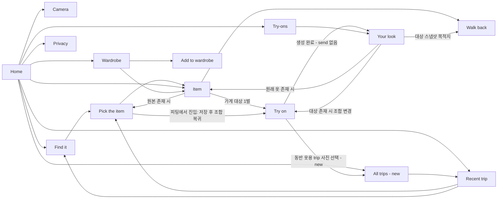

# 화면 구조와 공통 동작

상태: 인터뷰 R9까지 반영, 화면 배치는 프로토타입 세션에서 확정

근거: [decisions.md](../decisions.md) D-R1-03, D-R3-03, D-R3-10, D-R3-11, D-R4-03, D-R4-08, D-R4-09, D-R5-01, D-R7-08, D-R7-09. 라우트는 기능 수준 계약이며 실제 TS 타입은 구현에서 정한다.
R9 추가 근거: D-R9-03(결과 스냅샷·대상 삭제), D-R9-04(Visit 제거·Trip 통합).

## 화면 스택과 진입 규칙

- 바텀 탭은 없다. 홈이 스택 바닥이고 다른 화면은 한 단계씩 쌓인다. 새 화면은 오른쪽에서 들어오며 뒤 화면이 약간 밀리고 어두워지는 흐름을 Astryx로 근사한다(D-R1-03).
- 상단 뒤로 가기 또는 Android 뒤로 가기는 한 단계 복귀한다. 프로토타입에서는 `Esc`다. 시트가 열려 있으면 시트부터 닫는다(D-R1-03).
- 홈은 최근 trip 하나와 "All trips" 진입점이다. 탐색은 `Trips → Trip → Pick`이며 가게 정보는 Trip 안에 있다. 홈 "Today"/"All trips"에서 가게를 누르면 해당 Trip의 가게 위치로 이동한다 [추론, 배치는 프로토타입 세션에서 확정]. **프로토타입 미반영**(D-R3-03, D-R3-10, D-R9-04).
- `send` route와 별도 전송 확인 화면은 제거한다. `outfit`의 생성 작업 완료 후 `result`로 가고, 뒤로 가면 조합 화면으로 돌아간다. 생성 진행을 어디에 보일지는 **프로토타입 세션에서 확정**한다. **프로토타입 미반영**(D-R4-03).
- 피팅에서 trip 사진 선택을 시작하면 대상/동반 선택을 보존한 채 `trips` → `trip` → `pick`의 탭 분리를 연다. 완료는 조각 자동 저장 후 원래 `outfit`으로 반환하고 동반 최대 5를 지킨다. 취소/뒤로 가기는 조합을 잃지 않는다 [추론]. 일반 선택의 Item 완료 경로와 구분한다. **프로토타입 미반영**(D-R4-07, D-R4-08, D-R9-04).
- 길 안내 진입은 Item과 Result뿐이다. Trip의 가게 영역이나 사진 선택 화면에서 직접 안내를 시작하지 않는다. Result는 대상 삭제 후에도 스냅샷으로 안내하며, 대상이 없을 때 "Change pieces"만 비활성화한다. **프로토타입 미반영**(D-R9-03, D-R9-04).
- 홈 검색창은 Find it으로만 진입하며 마이크가 없다. 마이크는 Find it 입력창에만 있다. **프로토타입 미반영**(D-R7-09).

이 도표의 `trips`, Visit 없는 Trip 통합, 피팅 → trip 사진 선택/복귀, `send` 없는 생성 완료, 결과 스냅샷 목적지는 **프로토타입 미반영**이다(D-R3-10, D-R4-03, D-R4-08, D-R9-03, D-R9-04).

| 화면 | route 이름 | 진입·복귀의 기능 규칙 | 관련 기능·근거 / 프로토타입 상태 |
| --- | --- | --- | --- |
| "Home" | `home` | 앱 시작·알림 본문. 최근 trip, "All trips". 홈 마이크 없음 | F-01/09/10/14/16; D-R3-10, D-R7-09 / **프로토타입 미반영** |
| "Camera" | `capture` | 홈/알림 "Take photo", "New shop" 딥링크 | [F-02~04](capture.md); D-R2-01, D-R2-07 |
| "All trips" | `trips` | 홈·검색 미발견 직접 탐색·피팅 동반 사진 선택. 날짜별 목록 → Trip, 가게 선택 시 해당 위치 이동 [추론] | [F-05](capture.md#f-05-trip-화면에-가게-정보-통합); D-R3-03, D-R3-06, D-R3-10, D-R4-08, D-R9-04 / **추가, 프로토타입 미반영** |
| "Trip" | `trip` | 최근 trip 또는 목록에서 진입. 가게별 외관·묘사·메모 편집·사진 통합. 사진 → Pick, trip 삭제 | F-05; D-R3-03, D-R3-11, D-R9-04 / **프로토타입 미반영** |
| "Find it" | `ask` | 홈·"Find another"·Trip. 모든 trip 검색, 입력창 마이크만 제공 | [F-06/07](search.md); D-R3-03, D-R7-09, D-R9-04 |
| "Pick the item" | `pick` (`mode: shop`) | 검색·Trip 사진·존재하는 "Original photo". 일반 완료는 Item. 피팅용 완료는 저장 후 조합 복귀 | [F-08](search.md#f-08-옷-후보-선택); D-R4-08, D-R7-08, D-R9-04 / **프로토타입 미반영** |
| "Add to wardrobe" | `pick` (`mode: wardrobe`) | 옷장 추가에서 진입, 선택 후 옷장 복귀 | [F-10](tryon.md#f-10-옷장); D-R4-06 |
| "Item" | `item` | 선택·저장한 옷·옷장·결과 목록. 가게 옷만 대상 피팅 시작 | [F-09](tryon.md#f-09-저장한-옷과-옷-상세); D-R4-09 / 옷장 단독 진입 제거 **프로토타입 미반영** |
| "Try on" | `outfit` | 가게 대상 상세·대상이 남은 결과의 조합 변경. 동반 trip 선택 왕복. 생성 확인 route 없이 결과로 이동 | [F-11](tryon.md#f-11-피팅할-옷-조합-선택), [F-12](tryon.md#f-12-피팅-생성); D-R4-03, D-R4-08, D-R9-03 / **프로토타입 미반영** |
| "Your look" | `result` | 생성 완료·기록. 뒤로는 진입 경로로 복귀, 조합 생성 후에는 outfit | [F-13](tryon.md#f-13-피팅-결과); D-R4-03, D-R7-08 |
| "Try-ons" | `results` | 홈 → 결과 목록 → result. 삭제 제공 | [F-14](tryon.md#f-14-피팅-기록); D-R3-11, D-R7-08 / 삭제 **프로토타입 미반영** |
| "Walk back" | `walk` | Item 또는 Result에서만 진입. Item 촬영 위치 또는 Result 대상 스냅샷 위치 사용 | [F-15](walk.md); D-R5-01, D-R5-03, D-R9-03, D-R9-04 / **프로토타입 미반영** |
| "Wardrobe" | `wardrobe` | 홈 → 옷장 → 추가/상세 | [F-10](tryon.md#f-10-옷장); D-R4-06 |
| "Privacy" | `privacy` | 홈 방패 아이콘, 오프라인에도 열림 | [F-16](tryon.md#f-16-개인정보-안내); D-R7-08 |

`send`와 `visit`는 현행 route 표에 존재하지 않는다. 이전 프로토타입의 전송 확인과 별도 가게 화면을 실제 앱으로 이식하지 않는다(D-R4-03, D-R9-04).

## F-17 공통 동작

- **화면:** 모든 route의 상단 바·시트·토스트, Android 권한/알림 진입(D-R1-03, D-R2-01).
- **동작:** 스택 이동, 시트 닫기, 권한 안내와 알림 딥링크(D-R1-03, D-R2-10, D-R2-11).

### 기능 규칙과 상태(확정)

- 토스트는 2.6초 후 사라지고 시트가 열리면 바로 숨겨 문구를 가리지 않는다. 시트 바깥 탭으로 닫는다. 시각 표현은 Astryx로 근사한다(D-R1-03).
- 위치 거부 시 쇼핑 시작을 차단하고 "Open settings" 설명 시트를 띄운다. 알림 거부는 쇼핑을 막지 않고 카드 없음 토스트를 한 번 띄운다(D-R2-10, D-R2-11).
- 알림 본문은 홈, "Take photo"는 카메라, "New shop"은 새 가게를 시작한 카메라다. 이미 열린 동일 카메라를 중복 쌓지 않는다 [추론]. 다른 알림은 없다(D-R2-01, D-R2-02).
- 모든 trip 목록이 비면 빈 상태를 표시하며 존재하지 않는 trip/가게/사진으로 이동하지 않는다. trip/사진/옷/결과 삭제 후 사라진 상세를 스택이 다시 열지 않도록 유효한 상위 목록으로 복귀한다 [추론]. 구체적 확인·복귀 배치는 프로토타입 세션에서 확정한다(D-R3-03, D-R3-11).
- 오프라인이어도 홈·trip·사진·옷장·저장 옷·기록·Privacy는 로컬 데이터로 열린다. 검색·음성·피팅·길 안내 진입 시에는 연결 필요와 재시도를 안내한다(D-R6-03, D-R7-08).

### 화면 배치·문구

- 주요 버튼 하나를 시각적으로 강조하고 카메라에서만 상태 표시줄 밝은 글자를 쓴다. 고정 px 대신 Astryx 컴포넌트·토큰으로 근사한다(D-R1-03).
- 새 "All trips" 목록, 삭제 액션/확인, 피팅 trip 선택의 돌아오기, 진행/오프라인/실패/빈 화면과 새 문구는 **프로토타입 세션에서 확정**한다. 홈 마이크 제거와 전송 확인 제거는 기능상 확정이며 레이아웃 대기와 혼동하지 않는다(D-R3-10, D-R3-11, D-R4-03, D-R4-08, D-R6-03, D-R7-09).

### 실제 구현

- UI는 React 스택이며 네이티브 기능은 Capacitor 플러그인으로 호출한다. 권한/알림은 실제 Android UI다. 딥링크는 `streetfitting://home`, `streetfitting://capture`, `streetfitting://capture?newShop=1`을 사용한다(D-R2-01, D-R7-03; [device-modules](../contracts/device-modules.md)).

### 프로토타입

- OS 권한은 중앙 카드, 알림 창은 상태 표시줄 핫스팟 오버레이다. 호스트 문구 "Tap the status bar to pull down notifications"와 `Esc`로 알림부터 닫는 동작은 시뮬레이션이다. 실제 제품에 별도 가짜 OS UI를 만들지 않는다(D-R2-01, D-R2-10, D-R2-11).

## 프로토타입 미반영

| 결정 ID | 바뀌는 화면·동작 | 현재 프로토타입 |
| --- | --- | --- |
| D-R3-03, D-R3-10 | 최근 trip + `trips`("All trips") → 특정 trip | 오늘의 단일 trip |
| D-R3-11 | 삭제 후 참조/스택 정리·삭제 진입 | 삭제 경로 없음 |
| D-R4-03 | `send` 제거·생성 상태 위치 결정 | `outfit` → 전송 확인 → 결과 |
| D-R4-08 | 피팅 → trip 사진 → 탭 분리 → 자동 저장·조합 복귀 | 피팅 화면의 저장/옷장 타일만 있음 |
| D-R4-09 | 옷장 단독 대상 진입 제거 | 옷장 Item에서도 피팅 시작 |
| D-R5-01, D-R5-03 | 사진 목적지·결과 대상 옷으로 안내 | 가게 화면 직접 안내·첫 가게 옷 |
| D-R7-08 | 보조 화면은 유지, Privacy 내용·삭제 참조 수정 | 화면은 있으나 옛 경계/참조 |
| D-R7-09 | Find it 입력창만 마이크 | 홈 마이크 아이콘 있음 |
| D-R6-03 | 네트워크 기능의 연결 안내/재시도 | 고정 성공 흐름 |
| D-R9-03 | 결과 스냅샷으로 대상 삭제 후 안내 유지, "Change pieces" 비활성 | 삭제/스냅샷 없음 |
| D-R9-04 | `visit` 제거, Trips → Trip → Pick, 가게 정보 Trip 통합, Item/Result만 길 안내 | 별도 Visit route·직접 길 안내 |
