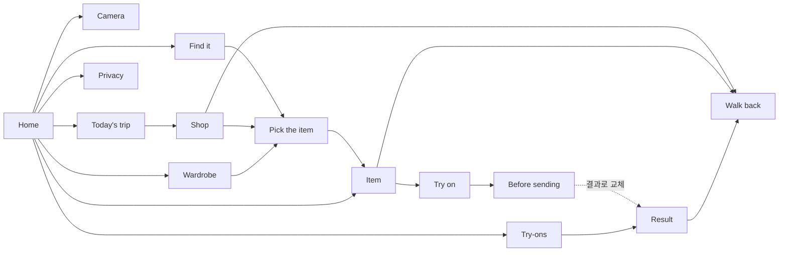

# Street Fitting 클릭 프로토타입

UI/UX 확인용입니다. 카메라, GPS, 모델 호출, 지도는 연결하지 않았고 모든 결과는 `src/data.ts`의 고정 데이터입니다. 화면 구성은 [stageshow](https://github.com/benjitaylor/skills/tree/main/stageshow) 키트(`src/kit`, MIT)의 `Stage`, `Phone(frame="android")`과 기본 부품 위에 만들었습니다. 색과 글꼴은 `app/`의 Hanok + Indigo 테마를 `src/look.css`로 옮겼습니다.

```sh
npm install
npm run dev   # http://127.0.0.1:5180
```

바텀 탭은 없습니다. 모든 화면은 홈에서 출발하는 스택으로 열리며, 상단 바에서 현재 깊이를 확인할 수 있습니다. 뒤로 가기는 화면 왼쪽 위 화살표 또는 `Esc`이고, `Reset`을 누르면 처음 상태로 돌아갑니다.



| 가짜로 처리한 부분 | 프로토타입 동작 |
| --- | --- |
| 카메라 | 샘플 사진을 순서대로 뷰파인더에 표시 |
| 에이전트 검색 | 질의 단어로 가게와 사진 3장을 고르고, 단계 표시를 시간차로 진행 |
| SAM 3.1 후보, EdgeTAM 탭 | 사진마다 미리 정한 박스, 탭하면 탭 지점 중심의 박스 3개 |
| 가상 피팅 결과 | 실루엣 위에 고른 옷 조각을 얹은 자리표시 이미지 |
| 길 안내 | 그려 둔 지도와 경로, `Demo` 버튼으로 한 걸음 진행 또는 경로 이탈 |

샘플 사진 출처와 라이선스는 `public/photos/CREDITS.md`에 있습니다.
