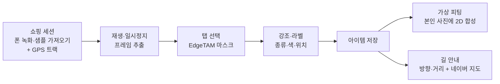
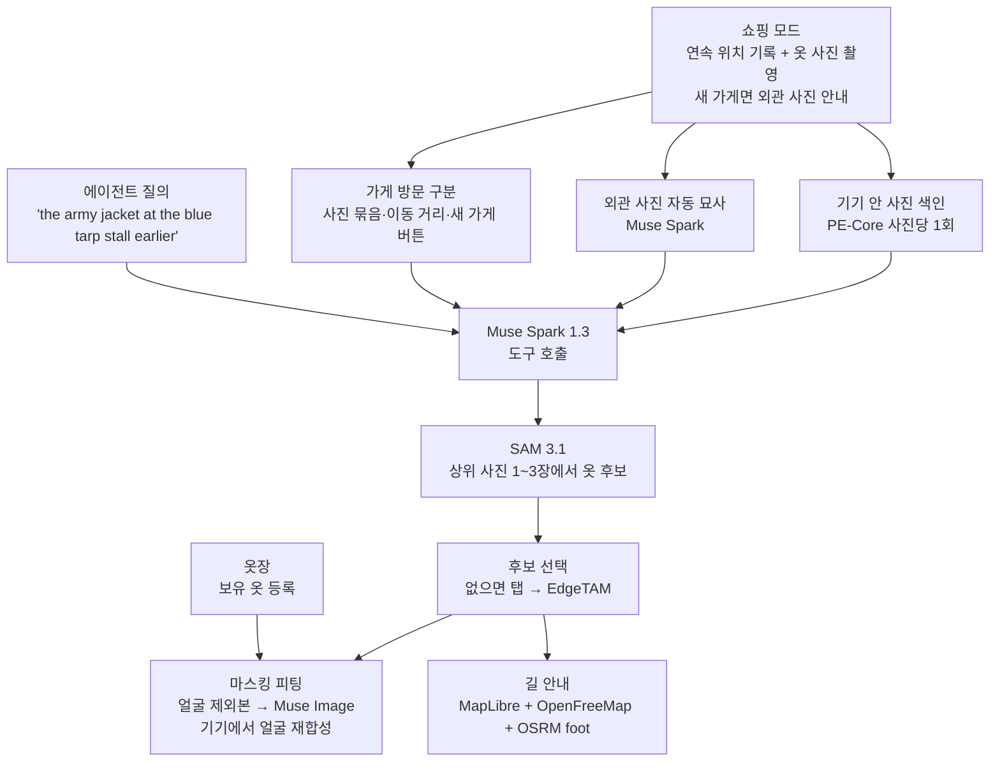

# 나만의 길거리 피팅 앱: 구현 가능성 조사와 MVP 범위

조사일: **2026년 11월 3일**  
요청 문서: [prompts/street-fitting-mvp.md](prompts/street-fitting-mvp.md)

Meta 공식 문서, GitHub·Hugging Face, Android·지도 공식 문서를 직접 열어 근거로 삼았다. 대부분은 문서 조사다. 직접 실행한 결과(6.4절 OSRM 경로 요청, 7.1절 에뮬레이터 측정, 8장 검색 점검·OSRM 요청)는 해당 위치에 근거를 적었다. Meta API는 호출하지 않았다(`MODEL_API_KEY` 없음). **[추론]**은 조사 결과를 바탕으로 한 판단이고, **미확인**은 찾아봤지만 근거를 얻지 못한 항목이다.

## 0. 요약 (11월 3일 최종)

이 문서는 네 차례 조사와 다섯 차례 합의를 거쳤다. 1~4장은 최초 전제(모든 AI 처리는 기기 안, 본인 사진 서버 전송 금지)에서 한 1차 조사다. 5장은 합의 기록이고, 6~8장은 바뀐 결정에 따른 추가 조사다. 5차 합의로 옷 기록 방식이 영상에서 사진으로 바뀌었으므로, 6~8장의 영상·장면 관련 내용은 당시 가정이다. 확정한 범위는 9장, 남은 과제는 10장에 있다.

- **확정한 MVP 흐름**
  1. 쇼핑 모드를 켜면 위치를 계속 기록한다. 마음에 드는 옷은 사진으로 찍고, 새 가게에서는 외관 사진을 한 장 찍는다(건너뛸 수 있음). 외관 사진은 Muse Spark가 짧은 설명으로 바꿔 둔다.
  2. 에이전트에게 "the army jacket at the blue tarp stall earlier"처럼 영어로 물으면, 에이전트가 방문 순서·시간·외관 설명으로 가게를 좁혀 사진을 찾고 SAM 3.1로 옷 후보를 뽑아 보여 준다.
  3. 고른 옷을 마스킹 피팅(Muse Image)으로 입혀 본다. 입힐 옷 조합(타깃 + 보유 옷, 타깃 + 타깃)은 사용자가 고른다.
  4. OSM 지도로 매장까지 걸어서 돌아간다.
- **처음 전제에서 바뀐 점**
  - 공개 앱이므로 중계 서버를 둔다.
  - 본인 사진은 기기에서 얼굴·머리를 뺀 편집본만 서버로 보내고, 원본 얼굴은 기기에서 다시 합성한다. 처음 전제대로라면 생성형 피팅은 불가능했다. Meta 이미지 생성 모델(Muse Image)이 API 전용이기 때문이다.
- **사용하는 Meta 모델**
  - 서버 API: Muse Spark 1.3(에이전트, 가게 외관 설명), SAM 3.1(옷 후보), Muse Image(피팅), Muse Voice Transcribe(P1 음성 질의).
  - 기기 안(ONNX): EdgeTAM(탭 분할), PE-Core(사진 색인).
  - DAT Mock Device Kit(P1 글래스 시연).
- **실측으로 확인한 것:** 이 Mac(M4)의 arm64 에뮬레이터에서 EdgeTAM 인코더 155 ms, 탭 1회 → 마스크 3개 17 ms, PE-Core 이미지 타워 35~40 ms/장이다. 실제 휴대폰 수치는 아니다. CC 이미지 22장 검색에서 1순위 적중은 6/7이었다.
- **비용:** Meta API는 개발과 시연을 합쳐 $33.80, 재시도 여유를 2배로 잡으면 $67.60이다(크레딧 $150, 8.2절 예산표). 인프라는 $0~5다.
- **언어:** 대상 사용자는 영어 사용자다. UI와 에이전트 질의 모두 영어만 쓴다.
- **아직 확인하지 못한 핵심:** 마스킹 피팅 품질과 얼굴 재합성, 질의 해석 정확도, 실제 매장 사진 검색 정확도, API 지연.
- **일정:** 범위는 해커톤 제출 마감(11월 5일 11:00 KST)과 무관하게 잡았다.

## 1. 전제와 충돌하는 지점

| 구상 | 관련 전제 | 조사 결과 | 선택지 |
| --- | --- | --- | --- |
| 이미지 생성으로 선택한 옷을 입은 **본인 모습** 확인 | 본인 사진 서버 전송 금지, 모든 AI 실행은 폰에서 | 불가. 이미지 생성 모델은 API 전용이고, 폰에서 실행할 Meta 생성 모델이 없음 | 기기 안 2D 합성(비생성) / 서버에서 옷만 정리하거나 가상 모델 착용 컷 생성(본인 아님) |
| "거기 있는 파란색 옷" 자연어 지정 | Meta 모델만, 폰에서 실행 | 제한적. 한국어 규칙 파서 + 영어 명사구 분할 모델 조합 필요 | 온디바이스 SAM 3(무거움) / 경량 후보 랭킹(정확도 낮음) / 매장 프레임을 API로 처리 |
| 음성 입력 | Meta 모델만, 폰에서 실행 | Meta 온디바이스 음성 인식 모델 없음. Muse Voice Transcribe는 API 전용. DAT Speech는 beta이고 한국어 미확인 | MVP 제외 권장 |
| 글래스로 위치 기록 | — | DAT에 위치 API 없음 | 폰 GPS 사용 |

## 2. 기능별 조사 결과

### 2.1 의류 지정·식별·추출

| 모델 | 입력 | 크기·라이선스 | 휴대폰 실행 | 용도 |
| --- | --- | --- | --- | --- |
| [EdgeTAM](https://github.com/facebookresearch/EdgeTAM) | 점·박스·마스크. **텍스트 불가** | 56 MB, Apache 2.0 | Qualcomm AI Hub가 TFLite/ONNX/QNN 변환본 제공. 이미지 인코더(w8a8) Snapdragon 8 Elite 3.0 ms, 8 Gen 3 4.5 ms, 7 Gen 4 8.2 ms([qualcomm/EdgeTAM](https://huggingface.co/qualcomm/EdgeTAM)). Meta 저장소는 iOS(CoreML) 변환만 제공 | 탭 선택, 앞뒤 프레임 추적 |
| [SAM 3](https://github.com/facebookresearch/sam3) | 텍스트 명사구, 예시 이미지, 점·박스 | 848M 파라미터, 체크포인트 3.45 GB, SAM License(상업 사용 허용, 재배포 시 라이선스 동봉) | 공식 모바일 변환 없음. 커뮤니티 [SAM3-LiteRT](https://huggingface.co/mlboydaisuke/SAM3-LiteRT): 텍스트 경로 약 1.7 GB(fp16), Pixel 8a 첫 질의 약 11초, 같은 프레임 재질의 약 1.9초. 영상 추적은 프레임당 약 16.6초(iPhone 17 Pro) | 자연어 지정(무거움) |
| [SAM 3.1](https://huggingface.co/facebook/sam3.1) | SAM 3과 같음. 영상 다중 객체 추적 개선 | 3.5 GB, 접근 승인 필요 | 모바일 변환 없음(미확인). [Model API](https://dev.meta.ai/docs/pricing-rate-limits) 이미지 1,000장당 $2.50 | 서버 사용 시 |
| [Perception Encoder (PE-Core) T/S](https://github.com/facebookresearch/perception_models) | 이미지·영어 텍스트 임베딩 | 비전 0.01~0.02B, Apache 2.0 | 공식 변환 없음. 크기상 ExecuTorch CPU(XNNPACK)로 충분 [추론] | 종류·패턴 라벨, 후보 랭킹, 보유 옷 유사도 |
| [Muse Glimmer](https://dev.meta.ai/docs/muse-glimmer) | 텍스트+이미지 → 텍스트 | 30B 단일 변형, 4-bit 약 17 GB | 불가. [ExecuTorch 경로는 CUDA·Apple silicon 전용](https://dev.meta.ai/docs/muse-glimmer/deploy) | 제외 |
| Llama 3.2 1B/3B | 텍스트 | Llama 3.2 Community License | ExecuTorch Android 데모 있음. 공식 지원 언어에 한국어 없음 | 제외 [추론] |
| MetaCLIP 2 | 다국어 이미지·텍스트 | **CC-BY-NC** | 크기상 가능 | 비상업 라이선스라 제외 |
| Sapiens2 | 인체 파싱(상의·하의 영역), 포즈 | 0.4B 이상, 라이선스에 biometric processing 금지 조항 | 모바일 변환·측정 없음 | 제외 |

**SAM 3 텍스트 프롬프트의 실제 범위** ([SAM 문서](https://dev.meta.ai/docs/sam/segmenting), [SAM 3 소개](https://ai.meta.com/blog/segment-anything-model-3/))

- "blue jacket"처럼 색·종류로 좁힌 짧은 명사구는 예측 가능하게 동작한다. 일치하는 대상이 없으면 0개를 반환한다.
- "on the left" 같은 위치 표현은 부분적으로만 반영된다. 공식 권장은 기본 개념만 분할한 뒤 앱에서 박스 좌표로 거르는 것이다.
- 긴 문장은 지원하지 않는다. 이를 보완하는 SAM 3 Agent의 예제 기본 언어 모델은 Qwen3-VL이라 "Meta 모델만" 조건에 맞지 않는다.
- Hugging Face 카드의 언어 표기는 en뿐이다. 한국어 프롬프트는 동작하지 않는다고 가정한다 [추론].

**자연어 지정 처리 흐름 [추론]**

1. 앱 안의 한국어 사전으로 색(파란·검정…), 종류(자켓·셔츠·바지…), 지시어(거기·왼쪽·가운데)를 뽑는다.
2. 영어 명사구로 바꾼다. 예: "파란색 옷" → `blue clothing`, "왼쪽 자켓" → `jacket` + 왼쪽 필터.
3. 후보를 만든다. RAM 12 GB 기기는 SAM 3 텍스트 경로, 그 외 기기는 EdgeTAM 격자 후보 + PE-Core 텍스트 유사도 랭킹.
4. 지시어로 후보를 거르고, 여러 개가 남으면 번호를 붙여 사용자가 고르게 한다.

서버 사용을 허용하면 Muse Spark가 한국어 질의를 받아 0–1000 정규화 좌표로 대상을 짚을 수 있고([Image understanding](https://dev.meta.ai/docs/image-understanding)), 이를 SAM 3.1 API 마스크로 이어 붙일 수 있다. 다만 매장 프레임 전체가 서버로 간다.

**실행 환경:** [ExecuTorch](https://github.com/pytorch/executorch) v1.5.1이 Android Java/Kotlin API와 CPU(XNNPACK)·GPU(Vulkan)·Qualcomm·MediaTek·Exynos 백엔드를 지원한다. 공식 Android 데모는 DeepLabV3와 LlamaDemo뿐이고 SAM 계열 Android 데모는 없다. 커뮤니티 SAM 3 포팅은 Google LiteRT 런타임을 쓴다. 모델은 Meta 것이지만, 해커톤이 런타임까지 제한하는지는 미확인이다.

### 2.2 가상 피팅·이미지 생성

**Muse Image** ([모델 소개](https://dev.meta.ai/models/muse-image), [Image generation](https://dev.meta.ai/docs/image-generation), [가격](https://dev.meta.ai/docs/pricing-rate-limits))

- API 전용(`muse-image-1.0`). 공개 가중치 언급이 없다.
- `/v1/images/edits`는 입력 이미지 1~10장을 받는다. Meta는 사람·사물·의류를 여러 참조 이미지에서 합성할 수 있다고 [소개](https://ai.meta.com/blog/introducing-muse-image-muse-video-msl/)한다.
- 마스크 편집은 지원하지 않고 텍스트 지시로만 편집한다. 얼굴·정체성 보존에 대한 정량 주장은 없다. 지연 시간은 미확인이다.
- 장당 $0.01, 팀당 150 RPM.

**Meta 공개 가중치 이미지 생성 모델:** Muse Glimmer는 텍스트만 출력한다. Chameleon은 이미지 생성 모델을 공개하지 않았다. DiT는 ImageNet 클래스 조건부 생성 모델이고 CC-BY-NC다. → **온디바이스 생성형 피팅은 불가능하다.**

**Model API 데이터 처리** ([Commitments](https://dev.meta.ai/legal/commitments), [Terms](https://dev.meta.ai/legal/terms-of-service), [ZDR](https://dev.meta.ai/help/policies-and-privacy/zero-data-retention))

- Muse Image와 SAM 3.1은 Standard 모델이라 입력을 Meta 모델 학습에 쓰지 않는다.
- 보관 기간은 고정 일수 없이 "필요한 만큼"이다(서비스 제공, 정책 위반 대응, 안전 검토).
- Responses API의 `store`는 기본값이 켜짐이고, 업로드 파일은 만료를 지정하지 않으면 남는다.
- 데이터 비보관(ZDR)은 영업 승인이 필요해 해커톤 기간에 쓰기 어렵다.

| 피팅 방식 | 본인 사진 비전송 | 모든 AI 폰 실행 | 품질 | 구현 공수 [추론] |
| --- | --- | --- | --- | --- |
| A. 기기 안 2D 합성: 잘라낸 옷을 본인 사진에 워프·합성, 어깨·밑단 핸들은 사용자가 맞춤 | ✅ | ✅ | 하~중(붙인 느낌) | 3~5시간 |
| B. A + 기기에서 잘라낸 옷 이미지만 Muse Image로 정면 제품 컷으로 정리한 뒤 기기에서 합성 | ✅ | ❌ | 중 | A + 2~4시간 |
| C. Muse Image로 가상 모델·마네킹 착용 컷 생성(옷 이미지 + 텍스트 체형) | ✅ | ❌ | 상(본인 아님) | 1~2시간 |
| D. 본인 사진 + 옷을 Muse Image에 전송 | ❌ | ❌ | 상(추정) | 제외 |
| E. A + Sapiens2로 자동 정렬·가림 처리 | ✅ | ✅ | 중상 | 8시간 이상, 변환·라이선스 리스크 |
| F. SAM 3D Body 기반 3D | — | — | — | 서버급 GPU 필요, 제외 |

본인 몸에서 뽑은 키포인트·실루엣만 서버로 보내는 방식은 사진은 아니지만 신체 정보다. 원칙 취지에 어긋난다고 보고 후보에서 뺐다 [추론].

### 2.3 메타글래스 촬영·앱 연동

근거: [DAT FAQ](https://developers.meta.com/wearables/faq/), [Meta Connect 2026 정리](https://developers.meta.com/blog/meta-connect-recap/), [DAT Android 저장소](https://github.com/facebook/meta-wearables-dat-android), [DAT 문서](https://wearables.developer.meta.com/docs/develop/dat/getting-started-toolkit), [허용 정책](https://wearables.developer.meta.com/acceptable-use-policy)

| 구상의 가정 | 실제 지원 |
| --- | --- |
| 글래스로 쇼핑 영상을 계속 녹화해 폰에 저장 | ✅ 영상 스트림 최대 720×1280, 2~30fps, HEVC over Bluetooth. 공식 샘플(CameraAccess)이 폰 녹화와 백그라운드 녹화를 포함. 접힘·과열·배터리로 끊기며 최대 녹화 시간은 미확인 |
| 옷을 고를 고화질 사진 | 스트림 중 사진 캡처는 지원. 4032×3024 단독 촬영은 experimental이라 게시 앱에 쓸 수 없음 |
| 영상 속 소리 | beta, 게시 앱 불가 |
| 글래스 GPS | ❌ 위치 API 없음 → 폰 GPS |
| 글래스에 이미 찍힌 사진·영상 가져오기 | ❌ API 없음(미확인) |
| Meta AI 기억·Live AI 결과 활용 | ❌ 서드파티 접근 없음. 기능 자체도 영어·미국/캐나다 한정 |
| "Hey Meta"로 앱 실행 | 개발·beta 채널에서만 |
| 하드웨어 없이 개발 | ✅ Mock Device Kit이 영상 파일(h.264/h.265)이나 폰 카메라를 글래스 카메라로 스트리밍. 실제 기기와 같은 API이며 `MockDeviceKit.disable()`로 전환 |
| 배포 | Developer Mode와 초대제 Beta 채널만 가능. 공개 제출은 "곧"이라고만 안내. Wearables Developer Center 지원 국가에 한국이 없음 |

- **요구사항:** Android 10+, Kotlin 2.2+, Meta AI 앱 V292+, 글래스 펌웨어 V128+.
- **정책:** 몰래 촬영, 녹화 표시등 가림, 얼굴·음성으로 사람을 식별하는 기능을 금지한다. 매장 상시 녹화보다는 사용자가 시작·중지하는 짧은 녹화로 설계해야 한다.

### 2.4 촬영·녹화 모듈과 임시 데이터 연결 [추론]

- 입력을 **쇼핑 세션 → 미디어(영상·사진) → 프레임** 하나의 구조로 통일한다. 세션은 GPS 트랙을 갖고, 미디어는 촬영 시작 시각을 갖는다. 프레임 시각으로 트랙에서 위치를 찾는다.
- 캡처 소스는 공통 인터페이스 하나 뒤에 둔다. 구현체는 폰 카메라(CameraX), 영상·사진 가져오기, 글래스(DAT, Mock 여부 플래그)다. 재생·선택·피팅 단계는 저장된 mp4/jpg와 타임스탬프만 받는다.
- 녹화 중 "찜" 버튼으로 표시한 시점이 재생 화면 진행 막대에 마커로 나온다. 일시정지한 프레임은 원본 해상도로 추출해 분석한다.
- 가져온 샘플 영상·사진에 위치가 없으면 지도에서 지정하거나 현재 위치를 쓴다. 시연용 샘플 세션에는 미리 만든 GPS 트랙을 넣는다.
- 1080p 연속 녹화는 저장 공간과 배터리 부담이 크므로 짧은 클립 단위 녹화를 권한다.
- CameraX는 영상 파일에 위치 하나만 기록한다([OutputOptions](https://developer.android.com/reference/androidx/camera/video/OutputOptions)). 프레임별 위치에는 별도 트랙이 필요하다.

### 2.5 기기 내 처리와 개인정보 [추론]

- **본인 사진:** 앱 전용 저장소에만 두고 갤러리에 등록하지 않는다. 본인 사진을 다루는 코드 경로에는 네트워크 호출을 두지 않는다.
- **쇼핑 영상:** 다른 손님 얼굴이 담긴다. 기기에만 보관하고 보관 기간을 정한다. 얼굴 식별 기능은 만들지 않는다(DAT·Model API 정책 모두 금지). 서버를 쓰는 경우에도 기기에서 잘라낸 옷 이미지만 보낸다.
- **위치:** GPS 트랙은 세션 동안만 기기에 두고, 세션이 끝나면 아이템 위치만 남기는 것을 기본값으로 한다.
- **모델 파일:** EdgeTAM 56 MB는 앱에 넣을 수 있다. SAM 3 텍스트 경로(약 1.7 GB)는 첫 실행 때 내려받아야 한다. 가중치를 배포하면 SAM License 사본을 함께 넣어야 한다.
- **기기 사양:** 권장은 RAM 12 GB, Snapdragon 8 Gen 3 / 8 Elite(Galaxy S24/S25급)다. RAM 8 GB 중급기에서는 탭 선택과 라벨링만 확실하고, 자연어 지정은 경량 방식으로 가야 한다.

### 2.6 GPS 위치 기록과 길 안내

**사실**

- `Location.getAccuracy()`는 실제 위치가 68% 확률로 들어가는 반경(m)이다([Location](https://developer.android.com/reference/android/location/Location)). 정밀 위치는 `PRIORITY_HIGH_ACCURACY`로 요청한다([위치 설정](https://developer.android.com/develop/sensors-and-location/location/change-location-settings)).
- 한국은 2026년 2월 구글에 지도 데이터 반출을 조건부 승인했다([NYT](https://www.nytimes.com/2026/02/27/world/asia/google-maps-south-korea.html)). 그러나 10월 말 기준 구글 지도는 한국에서 도보·자동차 길안내를 제공하지 않는다([Fizen 정리, 2026-10-27](https://blog.fizen.io/google-maps-walking-directions-korea-naver-vs-kakao-map-seoul-2026)).
- 네이버 지도는 `nmap://route/walk?dlat=..&dlng=..&dname=..&appname={applicationId}`로 도보 길찾기를 연다. 출발지를 생략하면 현재 위치에서 출발한다. 앱이 없으면 스토어로 보내야 한다([네이버 지도 URL Scheme](https://guide-gov.ncloud-docs.com/docs/naveropenapiv3-maps-url-scheme-url-scheme)).
- 카카오맵은 `kakaomap://route?sp=..&ep=..&by=foot`를 쓴다([카카오맵 URL Scheme](https://apis.map.kakao.com/android_v2/docs/api-guide/urlscheme/)).

**제안 [추론]**

- **앱 내 안내:** 지도 없이 거리·방향 화살표(나침반)와 도착 판정을 보여 준다. 외부 키나 서버 호출이 필요 없다.
- **외부 연동:** "네이버 지도로 길찾기" 버튼으로 도보 경로를 연다. 네이버 지도가 없으면 카카오맵으로 넘어간다. 지도 앱에는 매장 좌표만 넘어간다.
- **앱 안 지도 경로 표시:** 지도 SDK 키 발급과 경로 서버 호출이 필요해 MVP에서는 뺀다.
- **위치 정밀도:** GPS로는 건물 안 층과 매장을 구분할 수 없다. 정확도 반경을 함께 보여 주고, 반경이 크면 매장명·층 메모를 입력하게 한다. 매장 간판이 보이는 프레임 썸네일도 함께 저장한다.
- **전체 동선 기록:** 프레임과 위치를 잇는 데 녹화 중 트랙이 필요하다. 동선 시각화 기능은 MVP에 필요 없다.

### 2.7 보유 의류 매칭 [추론]

- **온디바이스로 가능한 것:** 옷장 사진 → EdgeTAM으로 옷 분리 → PE-Core 임베딩으로 "비슷한 옷이 이미 있음" 찾기, 새 옷과 보유 옷을 나란히 놓는 코디 보드.
- **불가능한 것:** "이 조합이 어울리는가" 같은 AI 스타일 판단. 한국어를 처리할 온디바이스 Meta 언어 모델이 없다. 서버를 허용하면 옷 이미지만 Muse Image(코디 이미지)나 Muse Spark(평가)로 보낼 수 있다.
- **공수:** 옷장 등록 화면, 저장, 임베딩까지 4~6시간.

### 2.8 탭·채팅 라벨링 UX [추론]

- **탭:** 탭 지점을 EdgeTAM에 넣어 마스크를 얻는다. 배경을 어둡게 하고 옷 윤곽선을 강조한 뒤 라벨 칩을 띄운다. 인코더는 프레임당 한 번만 돌고 이후 탭은 디코더만 돌아 즉시 반응한다.
- **수정:** 다시 탭하면 영역을 추가하고, 길게 누르면 제외하며, 되돌리기를 제공한다.
- **채팅:** 후보가 하나면 바로 강조한다. 여럿이면 번호 배지를 붙여 탭이나 번호로 고르게 한다.
- **라벨 내용:** 종류(PE-Core), 대표색(마스크 픽셀 통계, 모델 불필요), 시각·위치(자동), 매장명·메모(선택 입력).
- **저장 단위:** 원본 프레임 참조, 마스크, 투명 배경 옷 이미지, 라벨, 위치.

## 3. 임시 데이터로 시연할 수 있는 범위와 실제 연동이 필요한 부분

| 기능 | 임시 데이터·폰으로 시연 | 실제 연동·검증 필요 |
| --- | --- | --- |
| 쇼핑 기록 | 폰 녹화 + GPS 트랙, 샘플 영상 + 미리 만든 트랙 | 글래스 실기기 스트림, 장시간 녹화 안정성 |
| 옷 선택·추출 | 샘플 프레임에서 그대로 시연 | 글래스 영상 화질(최대 720p, 압축)에서 정확도 |
| 자연어 지정 | 정해 둔 한국어 문장 세트 | 자유 문장, 음성 |
| 가상 피팅 | 본인 또는 동의받은 인물 사진 | — |
| 길 안내 | 실제 매장 좌표 → 네이버 지도 | 실내·층 단위 정밀도 |
| 글래스 | Mock Device Kit으로 같은 API 경로 | 실기기, Meta AI 앱 페어링, 권한 심사, Beta 채널, 지원 국가 |
| 성능 | — | 데모 기기에서 지연·메모리 측정 |

## 4. 1차 MVP 범위 제안

| 구분 | 기능 |
| --- | --- |
| P0 | 쇼핑 세션(폰 녹화 + GPS 트랙, 샘플 영상·사진 가져오기를 같은 타임라인으로) |
| P0 | 재생·일시정지 → 탭 선택(EdgeTAM) → 강조·라벨(색: 픽셀 통계, 종류: PE-Core) → 아이템 저장 |
| P0 | 가상 피팅: 본인 사진 위 기기 안 2D 합성, 핸들로 정렬 |
| P0 | 길 안내: 앱 내 방향·거리 + 네이버 지도 도보 길찾기 연동 |
| P1 | 채팅 지정(한국어 규칙 파서 + SAM 3 또는 경량 랭킹) |
| P1 | Mock 글래스 캡처 소스 |
| 제외 | 생성형 본인 피팅(전제상 불가), 음성 입력, 실제 글래스 연동, 동선 시각화 |
| 미정 | 보유 의류 매칭, 서버 사용 범위 |

**심사 기준과의 관계:** Meta 도구 활용(25%) 항목에서 EdgeTAM·SAM 3·PE-Core·ExecuTorch·DAT를 온디바이스로 쓰는 구성은 "본인 사진은 기기 밖으로 나가지 않는다"는 차별점과 함께 설명할 수 있다. Muse Image·SAM 3.1 API는 서버 사용을 허용할 때만 추가된다 [추론].

## 5. 합의 기록

### 1차 합의 (11월 3일)

| 항목 | 결정 | 1차 제안과 달라진 점 |
| --- | --- | --- |
| 일정 | 해커톤 제출 마감(11월 5일)과 무관하게 범위를 잡는다 | 하루 분량 제한을 없앰 |
| 옷 지정 | 자연어·채팅 지정은 하지 않는다. 일시정지한 화면에서 앱이 의류 후보만 골라 표시하고, 사용자가 하나를 탭한다 | 채팅 지정 P1 → 제외. 의류 후보 자동 검출이 새로 필요 |
| 가상 피팅 | 생성형 피팅을 위해 본인 사진과 선택한 옷을 서버로 보내는 방식을 검토한다. 본인 사진은 기기에서 마스킹한 뒤 보낸다 | "본인 사진 서버 전송 금지" 전제를 마스킹 조건부 전송으로 바꾸는 방향. 마스킹 범위는 2차 조사 후 확정 |
| 보유 의류 | 보유 옷과의 유사도 매칭은 제외한다. 보유 옷을 새 옷과 함께 입혀 보는 피팅은 포함한다 | 옷장 등록과 여러 벌 동시 피팅이 필요 |
| 글래스 | P1: DAT Mock Device Kit으로 Mock 글래스 캡처 소스를 시연한다 | 제안대로 |
| 길 안내 | 글로벌 심사를 고려해 구글 지도를 우선 검토한다. 한국 시연이 가능한지와 대안을 추가 조사한다 | 네이버 지도 중심 → 구글 지도 우선 + 대안 조사 |
| 기기 | 보유 기기 Galaxy S21+와 Android 에뮬레이터(Apple Silicon Mac)를 함께 고려한다 | 권장 사양(RAM 12 GB 플래그십)보다 낮은 기기 |

### 2차 합의 (11월 3일, 6장 조사 후)

| 항목 | 결정 | 이전 결정과 달라진 점 |
| --- | --- | --- |
| 제품 형태 | 여러 사용자가 각자 자기 기기에서 쓰는 공개 앱이다. 앱과 Meta Model API 사이에 백엔드 서버(중계)를 둔다. 보안은 계속 중요하게 다룬다 | "직접 관리하는 서버 포함 전송 금지" → 마스킹 이미지에 한해 중계 서버 경유 허용 |
| 본인 사진 | 서버로 보낼 때는 기기에서 얼굴·머리를 마스킹한 편집본만 보낸다. 사용자 본인 화면에서는 원본(얼굴 포함)을 그대로 본다 | 마스킹 범위 확정. 자르기와 덮기 중 어느 쪽으로 할지는 PoC로 정함 |
| 길 안내 | 앱 안 지도와 도보 경로를 OpenStreetMap 기반(MapLibre + OSM 도보 경로)으로 만든다 | 구글 지도 우선 → OSM 앱 내 경로 |
| 계획 기준 기기 | 실제 기기 대신 Android 에뮬레이터(Apple Silicon Mac)를 기준으로 계획한다 | S21+ 병행 → 에뮬레이터 기준 |
| 옷 후보 표시 | 온디바이스로 되는지 답을 들은 뒤 다시 고른다 | 보류 |

계획 기준 Mac은 Apple M4, RAM 16 GB, 10코어다. Android SDK, 에뮬레이터, 시스템 이미지가 이미 설치돼 있다. 남은 디스크는 약 34 GB다.

### 3차 확인 항목

- 탭 지점 후보의 온디바이스 실현성: EdgeTAM 다중 마스크를 직접 export해 실행하고, PE-Core로 옷만 걸러 지는지 Mac과 에뮬레이터에서 확인한다.
- OSM 앱 내 길 안내 구성: 지도 타일, 도보 경로 서버, 턴바이턴 UI, 비용.
- 중계 서버 보안: 키 보호, 앱 인증, 남용 방지, 이미지 비저장, 개인정보 보호법·위치정보법.

### 3차 합의 (11월 3일, 7장 조사 후)

| 항목 | 결정 | 이전 결정과 달라진 점 |
| --- | --- | --- |
| 장면 찾기·옷 후보 | 사용자가 영상을 직접 뒤지지 않는다. 에이전트에게 "아까 ○○에서 봤던 ○○ 옷"이라고 말하면, 에이전트가 쇼핑 기록(위치·시각·영상)으로 장면을 찾고 SAM으로 옷 후보를 뽑아 보여 준다. 사용자는 후보 중 하나를 고른다 | 재생·일시정지 후 탭 → 에이전트 질의 기반 검색. 자연어 입력이 장면 검색용으로 다시 들어옴 |
| 비용 | 실제 운영이 아니라 MVP 구현이 목적이다. 정상 동작을 유지하면서 비용을 최소화한다 | GraphHopper 유료 요금제, 자체 호스팅 지도 타일 등 운영용 구성 재검토 |
| 도보 경로 | 비용 최소화와 에이전트 도입에 맞춰 다시 정한다 | 보류 |
| 서버 구성·안내 화면 | 동작은 유지하고 비용을 줄이는 방향으로 다시 점검한다 | 보류 |

### 4차 확인 항목

- 에이전트 장면 검색: Meta 모델 구성(언어 모델, 음성 입력, 기기 안 장면 색인, SAM 3.1), 서버로 가는 데이터, 비용.
- 비용을 최소화한 구성: 중계 서버 무료 사용량, 무료 지도 타일과 경로 서버, MVP 단계 Meta API 비용.

### 4차 합의 (11월 3일, 최종)

| 항목 | 결정 |
| --- | --- |
| 음성 질의 | P1. 기본은 텍스트 입력이고, 마이크 버튼을 누른 짧은 구간만 Muse Voice Transcribe로 보낸다 |
| 매장 장면 속 다른 사람 | MVP에서는 별도로 처리하지 않는다. 복잡도를 줄이기 위한 결정이며, 공개 배포 전에 다시 검토한다 |
| 도보 경로·서버 구성 | 8.2절의 비용 최소화 구성(OpenFreeMap, FOSSGIS OSRM foot, 로컬 Mac / Cloud Run 중계, Firebase 무료 사용량)을 따른다 |
| 최종 범위 | 9장 범위로 확정한다 |

### 5차 합의 (11월 3일, 입력 방식 변경)

| 항목 | 결정 | 이전 결정과 달라진 점 |
| --- | --- | --- |
| 옷 기록 | 연속 영상 촬영과 영상에서의 추출은 하지 않는다. 사용자가 마음에 드는 옷을 사진으로 찍는다 | 영상 녹화·영상 장면 색인 → 사진 촬영·사진 색인 |
| 위치 기록 | 쇼핑 모드 동안만 계속 기록한다. 사용자가 시작하고 종료하며, 기록 중에는 알림을 띄운다 | 녹화 중 트랙 → 쇼핑 모드 동안 연속 기록 |
| 옷 지정 시점 | 질의할 때 지정한다. 촬영은 셔터만 누르고, 나중에 에이전트가 사진을 찾아 SAM 3.1로 후보를 뽑는다 | 유지 |

### 6차 합의 (11월 3일, 세부 사항)

| 항목 | 결정 |
| --- | --- |
| 언어 | UI와 에이전트 질의 모두 영어만 쓴다. 대상 사용자는 영어 사용자다(처음에는 "UI 영어, 질의는 한국어·영어"로 정했다가 질의도 영어로 바꿈) |
| 피팅할 옷 | 사용자가 직접 고른다. "타깃 + 보유 옷", "타깃 + 타깃" 조합을 모두 허용한다. 개수 한도는 Muse Image 입력 한도(본인 사진 1장 + 옷 최대 9장)를 따른다 |
| 가게 구분 | 동 이름 라벨은 쓰지 않는다. 주 대상인 동묘 같은 로드샵은 검색으로 찾기 어렵고, 동 단위로는 가게가 구분되지 않기 때문이다. 대신 다음 세 가지를 쓴다. ① 가게 외관 사진(새 가게일 때 촬영 안내, 건너뛸 수 있음) ② 방문 순서·시간 ③ 외관 사진 자동 묘사(Muse Spark). 지도 핀 선택, 기준점 위치 설명, 짧은 메모는 넣지 않는다 |

**근거:** 동묘앞역 반경 400 m의 OSM을 Overpass API로 조회했다. 상점 129곳 중 의류점(`shop=clothes`)은 2곳뿐이고, 대부분은 문구·완구점이다. 지하철 출구 10개와 이름 있는 길 47개는 등록돼 있다(11월 3일 조회). 붐비는 시장에서는 GPS 오차(10~20 m)가 가게 간격보다 크다 [추론]. 그래서 한곳에 머문 시간만으로는 붙어 있는 가게가 하나로 합쳐질 수 있다.

## 6. 2차 조사 결과

1차 합의를 반영해 길 안내, 마스킹 후 생성형 피팅, 의류 후보 표시, 기기와 에뮬레이터를 추가로 조사했다. 이번에도 API 호출과 기기 실측은 하지 않았다.

### 6.1 기기: Galaxy S21+와 에뮬레이터

- **한국형 Galaxy S21+(SM-G996N)는 Exynos 2100, Mali-G78 MP14, RAM 8 GB다.** 최신 공식 펌웨어는 Android 15(One UI 7)다([삼성 사양](https://www.samsung.com/sec/support/model/SM-G996NZKEKOO/), [Exynos 2100](https://semiconductor.samsung.com/processor/mobile-processor/exynos-2100/exynos-2100-static/), [펌웨어](https://doc.samsungmobile.com/SM-G996N/KOO/doc.html)). 보유 기기의 모델 번호는 아직 확인하지 않았다.
- **NPU 가속은 쓸 수 없다.** ExecuTorch의 Samsung 백엔드는 Exynos 2500/2600만 지원한다([ExecuTorch Samsung](https://docs.pytorch.org/executorch/stable/backends/samsung/samsung-overview.html)). 실행 경로는 CPU(XNNPACK, LiteRT CPU)와 GPU(ExecuTorch Vulkan, LiteRT GPU)다. 1차 조사에 인용한 Qualcomm 측정값은 이 기기에 적용되지 않는다.
- **S21+에서 검증된 모델 실행 수치는 없다.** EdgeTAM, PE-Core, SAM 3 모두 실측해야 한다. 1.7 GB인 SAM 3 커뮤니티 포팅은 기본 경로로 쓰지 않는다 [추론].
- **에뮬레이터(Apple Silicon, arm64 AVD)가 지원하는 것**([가속](https://developer.android.com/studio/run/emulator-acceleration), [명령줄](https://developer.android.com/studio/run/emulator-commandline), [확장 제어](https://developer.android.com/studio/run/emulator-extended-controls), [화면 녹화](https://developer.android.com/studio/run/emulator-record-screen))
  - CPU 모델 실행: 하이퍼바이저로 호스트 CPU에서 직접 돈다. GPU 위임 실행은 보장되지 않는다.
  - 영상 파일을 카메라 입력으로 넣기: `-camera-back videofile:경로`. CameraX 녹화도 된다.
  - 위치: 고정 좌표, GPX/KML 경로 배속 재생.
  - Google Play 이미지에서 구글 지도·네이버 지도 설치, 내장 화면 녹화(WebM).
- **DAT Mock은 Meta AI 앱 없이 등록·권한을 흉내 낸다**([Mock Device Kit](https://wearables.developer.meta.com/docs/develop/dat/mock-device-kit)). 다만 공식 예제에 Bluetooth 권한 부여가 남아 있고, 에뮬레이터에서 HEVC 스트림이 도는지는 미확인이다.

| 시연 장면 | 권장 장비 [추론] |
| --- | --- |
| 매장 촬영 | S21+ |
| 재생 → 일시정지 → 옷 후보 → 선택 | 에뮬레이터(같은 프레임으로 반복 녹화). 처리 속도 주장은 S21+ 실측으로만 |
| 마스킹 → 서버 피팅 | 에뮬레이터 |
| 매장 위치 → 외부 지도 | 에뮬레이터 녹화, S21+ 최종 확인 |
| 나침반 방향·실외 복귀 | S21+ |
| Mock 글래스 | S21+ 먼저. 에뮬레이터는 동작 확인 후 |

### 6.2 의류 후보 표시

| 방식 | 동작 | 서버 전송 | 비용·성능 | 리스크 |
| --- | --- | --- | --- | --- |
| A. 탭 지점 후보(온디바이스) | 옷을 탭하면 EdgeTAM이 그 지점에서 마스크 3개(옷 전체, 옷 일부, 사람 전체 등)를 만든다. PE-Core로 옷이 아닌 마스크를 걸러 1~3개를 보여 준다 | 없음 | 인코더 1회 + 디코더 1회 + PE 최대 3회. S21+ 지연 미확인 | 화면 전체 옷 목록은 아님. PE-Core 필터 기준을 매장 샘플로 정해야 함 |
| B. 화면 전체 자동 후보(서버) | 일시정지 프레임을 SAM 3.1 API에 옷 종류별(셔츠·재킷·원피스·바지 등)로 보내 모든 옷을 강조한다 | 일시정지 프레임 | 종류당 $0.0025, 4종이면 프레임당 $0.01. 지연 미확인 | 다른 손님 얼굴이 담긴 프레임 전송. 업로드 전 사용자 가림 필요 |
| C. 화면 전체 자동 후보(온디바이스) | EdgeTAM 자동 마스크 생성(기본 32×32=1,024점) + PE-Core 필터 | 없음 | 디코더·PE 호출이 많아 수 초 이상 예상 [추론]. 실측 없음 | 개발량과 지연 리스크가 가장 큼 |

- **EdgeTAM의 다중 마스크 출력:** 점 하나를 넣으면 마스크 3개를 돌려준다(`multimask_output`, [EdgeTAM 예측기 코드](https://github.com/facebookresearch/EdgeTAM/blob/main/sam2/sam2_image_predictor.py)). 자동 마스크 생성기도 공식 저장소에 있다.
- **SAM 3.1 API**([프롬프트 문서](https://dev.meta.ai/docs/sam/segmenting), [개요](https://dev.meta.ai/docs/sam/overview))
  - 요청 하나에 개념 하나만 받는다. "shirt, jacket" 같은 목록을 넣으면 0개를 돌려준다.
  - 결과는 전용 토큰 텍스트로 오며 Meta 파서로 풀어야 한다. 신뢰도도 함께 받을 수 있다.
  - `clothing` 한 단어로 모든 옷을 빠짐없이 찾는다는 근거는 없다. 옷걸이·랙·착용복별 정확도도 미확인이다.
- **공통 예외 처리:** 후보가 없거나 원하는 옷이 빠졌으면 사용자가 그 옷을 직접 탭하고 EdgeTAM 점 지정으로 넘어간다.

### 6.3 마스킹 후 생성형 피팅

**Muse Image에서 확인한 것** ([Image generation](https://dev.meta.ai/docs/image-generation), [Muse Image 발표](https://ai.meta.com/blog/introducing-muse-image-muse-video-msl/))

- 입력 이미지는 1~10장이다. 본인 편집본 + 새 옷 + 보유 옷을 한 요청에 넣을 수 있다.
- 다음은 미확인이다. 피팅을 PoC로 검증해야 하는 이유이기도 하다.
  - 마스킹한 인물 사진으로 피팅한 공식 사례.
  - 가린 얼굴 자리를 비워 두는지, 새 얼굴을 그려 넣는지.
  - 출력이 입력과 픽셀 단위로 정렬되는지.
- `mask` 파라미터는 지원하지 않는다. 마스킹은 전송 전 이미지 자체를 가리는 방식이어야 한다. `size`는 비율만 정한다.
- 안전 필터에 걸리면 400 `content_policy_violation`을 돌려준다.
- [허용 정책](https://dev.meta.ai/legal/acceptable-use-policy)상 출력의 워터마크·메타데이터를 지우면 안 된다. 얼굴을 재합성한 공유용 파일을 만들 때 이를 지키는 방법은 미확인이다.
- 약관상 최종 사용자는 만 18세 이상이어야 한다.

**서버 보관을 줄이는 설정** ([Responses](https://dev.meta.ai/docs/protocols/responses), [File handling](https://dev.meta.ai/docs/file-handling), [Terms](https://dev.meta.ai/legal/terms-of-service))

- 이미지는 요청에 base64로 직접 넣는다. Files API를 쓰지 않아도 된다.
- Responses API에서 `store:false`로 대화 저장을 끈다.
- 이미지 검색·웹 검색·셸 도구를 끈다.
- 이 설정을 모두 해도 Meta는 서비스 제공·안전 목적으로 필요한 만큼 보관할 수 있다. 익명화나 즉시 삭제가 아니다.

| 마스킹 방식 | 서버로 가는 것 | 남는 식별 단서 | 얼굴 재합성 |
| --- | --- | --- | --- |
| (a) 전신 + 머리 전체를 단색으로 덮음 | 몸, 배경, 덮인 머리 | 체형, 피부, 문신, 배경 | 원래 좌표에 붙이기 쉬움. 모델이 사람을 옮기거나 머리를 다시 그리면 실패 |
| (b) 얼굴·머리를 뺀 부분만 잘라 보냄 | 목 아래 몸(상·하의 함께 입히면 발까지) | 체형, 피부, 문신, 배경 | 잘라낸 위치를 기기에 보관해 다시 붙임. 목·어깨 연결이 어긋날 수 있음 |
| (c) (a) 또는 (b) + 배경 제거 | 몸만 | 체형, 피부, 문신 | 배경 분할과 합성이 추가로 필요 |

**피팅 흐름 제안 [추론]**

1. 촬영 가이드에 맞춰 본인 사진을 찍는다. 원본은 기기에만 둔다.
2. 기기에서 얼굴·머리를 잘라내거나 덮는다. 기본은 사용자가 조정하는 자르기·덮기 영역이고, EdgeTAM은 보조로 쓴다. Sapiens2는 라이선스의 biometric processing 금지 조항 때문에 쓰지 않는다.
3. 실제로 전송될 이미지를 다시 보여 주고 사용자 확인을 받은 뒤에만 보낸다. EXIF·GPS는 제거한다.
4. Muse Image에 편집본, 새 옷, 보유 옷을 보낸다(`store:false`, 도구 끔).
5. 결과 크기를 원래 영역에 맞추고, 원본 얼굴을 기기에서만 합성한다. 연결이 부자연스러우면 얼굴 없는 결과로 표시하고 다시 촬영하게 한다.

**PoC [추론]:** 성인 본인 사진 2장 × 마스킹 3종 × `reasoning_strength` low/high로 12회 요청한다. 가장 나은 조합을 3회 반복하고 상의만 입히는 경우 1회를 더해 16장, 약 $0.16이다. 얼굴 노출, 출력 크기, 지연, 옷 색·무늬 보존, 목·어깨 정렬을 기록한다.

**API 호출 경로:** 앱이 Meta API를 직접 호출하면 API 키가 앱에 들어가므로 공개 배포할 수 없다. 중계 서버를 두면 키를 보호할 수 있지만, 마스킹 이미지가 직접 관리하는 서버를 거친다.

### 6.4 길 안내

**사실**

- **구글 지도로는 한국 도보 길안내가 안 된다.** Google Maps Platform과 Navigation SDK 공식 지원표에서 한국의 도보·자동차 경로는 미지원이다([지원표](https://developers.google.com/maps/coverage), [Navigation SDK 지원표](https://developers.google.com/maps/documentation/navigation/android-sdk/coverage-nav-sdk)). 10월 27일 이후 개통이나 확정 일정은 찾지 못했다.
- **구글 지도 URL은 키 없이 열 수 있지만 지역 제한을 우회하지 못한다.** 지원하지 않는 지역에서는 `dir_action=navigate`가 무시된다([Maps URLs](https://developers.google.com/maps/documentation/urls/get-started)).
- **OSM 기반 도보 경로는 서울에서도 동작했다.** FOSSGIS OSRM foot 서버에 서울 좌표 두 개로 요청해 1,014.7 m·814초 경로를 받았다([서버 안내](https://routing.openstreetmap.de/about.html)). 공용 서버는 초당 1회 제한이 있다. osmdroid는 보관(archive) 상태이고, GraphHopper Android 오프라인 경로는 공식 지원이 끝났으며, OSM 공용 타일은 오프라인 다운로드가 금지돼 있다.
- **Mapbox·HERE는 확정할 수 없다.** Mapbox의 한국 도보 경로는 미확인이고, HERE 한국 서비스는 한국 IP에서만 쓸 수 있다.

| 방식 | 내용 | 작업량 [추론] | 비용·개인정보 |
| --- | --- | --- | --- |
| A. 앱 내 복귀 카드 + 지역별 외부 지도 | 앱에서 직선 거리·방향·도착 확인을 하고, 경로는 목적지가 한국이면 네이버 지도, 해외면 구글 지도로 넘긴다 | 3~5인일 | 키 불필요. 버튼을 누를 때만 지도 앱에 좌표 전달 |
| B. 앱 안 지도·도보 경로 | MapLibre + 계약형 OSM 타일 + OSM 도보 경로 서버. 한국과 해외가 같은 화면 | 5~8인일, 안정화 포함 8~12인일 | 타일·경로 서비스 키와 요금. 출발·도착 좌표가 경로 서버로 감. 보행 경로 품질 현장 확인 필요 |
| C. 구글 지도만 | 구글 지도 도보 길찾기로 넘긴다 | 1~2인일 | 한국 시연에서 도보 경로가 나오지 않음 |

## 7. 3차 조사 결과

### 7.1 탭 지점 옷 후보: 에뮬레이터 실측

EdgeTAM과 PE-Core-T16을 직접 ONNX로 export해 이 Mac의 arm64 에뮬레이터(`Medium_Phone`, API 37)에서 CPU(ONNX Runtime)로 실행했다. 시험 사진은 Wikimedia Commons의 [중고 매장 옷걸이](https://commons.wikimedia.org/wiki/File:Inside_the_second_hand_shop,_clothing_racks.jpg)(CC BY-SA 4.0)와 [매장 안 인물](https://commons.wikimedia.org/wiki/File:Man_examines_clothing_in_a_boutique_while_shopping_for_fashionable_attire_in_a_trendy_store_setting.jpg)(CC BY 2.0) 두 장이다.

| 단계 | 에뮬레이터 측정(워밍업 후 5회 중앙값) |
| --- | --- |
| EdgeTAM 이미지 인코더 | 154.95 ms |
| 탭 1회 → 마스크 3개 디코더 | 16.60 ms, 출력 `[1,3,256,256]` + 점수 3개 |
| PE-Core-T16 이미지 타워(후보 1개당) | 35.35~39.95 ms |
| 모델 파일 | EdgeTAM 인코더 18.8 MiB + 디코더 15.7 MiB + PE 이미지 타워 30.5 MiB |

- **실행은 된다.** 직접 만든 export가 다중 마스크를 그대로 돌려주고, Mac과 에뮬레이터 결과가 일치한다(마스크 IoU 1.0). 같은 프레임을 다시 탭하면 인코더를 다시 돌릴 필요가 없다.
- **마스크 3개는 옷 3벌이 아니다.** 같은 탭에 대한 범위 3단계다. 인물 사진에서는 사람 전체, 셔츠+팔, 조끼 부분으로 나뉘었다.
- **PE-Core-T16으로는 옷만 자동으로 걸러낼 수 없다.** 착용한 상의를 `pants`로 분류했다. 단순 기준(옷 점수 − 비의류 점수 ≥ 0.02)을 쓰면 옷걸이 사진에서 1개, 인물 사진에서 0개만 남았다. 사진 2장 결과라 일반화할 수는 없다.
- **Android 16 KB 페이지 문제:** 처음에는 API 37 이미지에서 네이티브 실행 파일이 segfault로 종료됐다. 16 KB 정렬 링크 옵션(`-Wl,-z,max-page-size=16384`)을 넣어 해결했다([16 KB 페이지](https://developer.android.com/guide/practices/page-sizes)).
- **아직 측정하지 않은 것:** 앱 안에서 탭부터 화면 표시까지 걸리는 시간, 메모리 최대치, 실제 휴대폰 성능.
- **화면 전체 옷을 기기 안에서 자동으로 찾는 방식**(SAM 3 1.7 GB 포팅, EdgeTAM 자동 마스크 1,024점)은 에뮬레이터에서 측정하지 않았다.

재현 코드와 결과물은 `/tmp/edgetam-poc/`에 있다(임시 경로).

### 7.2 OSM 앱 내 길 안내 구성

| 구성 요소 | 권장 [추론] | 근거·조건 |
| --- | --- | --- |
| 지도 렌더링 | MapLibre Native Android 13.7.1 | [릴리스](https://github.com/maplibre/maplibre-native/releases). PMTiles 지원 |
| 지도 타일 | Protomaps 전 세계 PMTiles(약 120 GB)를 우리 저장소·CDN에 호스팅 | `name:ko`, `name:en` 포함([Protomaps](https://docs.protomaps.com/basemaps/downloads)). 개발 초기에는 [OpenFreeMap](https://openfreemap.org/)(무료, 상업 사용 허용, SLA 없음)으로 시작 가능 |
| 도보 경로 | 우리 백엔드를 거쳐 GraphHopper 호스팅(Basic €69/월, 하루 5,000 크레딧, 초당 1회) | 전 세계 도보 지원, 프록시 사용 명시 허용. 단 요청 본문·좌표를 독일 서버에 최대 5주 보관([개인정보 정책](https://www.graphhopper.com/privacy/)) |
| 안내 UI | 경로선, 현재 위치, 남은 거리·시간, 다음 안내, 경로 이탈 시 재탐색, 매장 도착 카드 | 음성 안내와 백그라운드 안내는 제외. 풀 턴바이턴이 필요하면 Ferrostar 0.59 추가(3~6인일) |
| 공수·비용 | 지도·길 안내 8~12인일. 소규모 기준 월 약 €69 + US$7~30 | 앱 전체 공수가 아님 |

- **제외한 공급자:** Stadia는 일반 프록시·캐시를 금지하고, 약관에 한국 지도 데이터 반출 제한 조항이 있다([약관](https://stadiamaps.com/terms-of-service/)). openrouteservice는 개인데이터 전송을 금지한다.
- **한국 OSM 보행 데이터 현황:** `footway=sidewalk` 53,277개, `footway=crossing` 48,270개가 있지만 실내 복도(`indoor=corridor`)는 34개뿐이다([Taginfo](https://taginfo.geofabrik.de/asia:south-korea/)). 도착은 "매장 근처 + 외관 사진 + 층·출입구 메모"로 정의한다.
- **자체 경로 서버(한국만):** 빌드 RAM 4~8 GB, 실행 2~4 GB면 시작할 수 있다 [추론]. 좌표가 외부 업체로 가지 않지만, 해외 경로는 따로 해결해야 한다.

### 7.3 중계 서버 보안

**허용 범위와 한도**

- 전용 앱 백엔드가 최종 사용자 요청을 Meta Model API에 전달하는 구조는 약관상 허용된다(Integrated Product). Meta API를 범용 프록시로 제공하는 것과 API 키를 앱에 배포하는 것은 금지다([약관 §1·§3.1·§10.1](https://dev.meta.ai/legal/terms-of-service)).
- 최종 사용자는 만 18세 이상이어야 한다.
- Muse Image 호출 한도는 팀 전체 150 RPM이다. 사용자를 구분하는 값은 `safety_identifier`에 가명 ID로 넣는다([Responses 스키마](https://dev.meta.ai/docs/api-reference/responses/schemas)).

**권장 구성 [추론]**

- 서버: 서울 리전 Cloud Run + Secret Manager.
- 앱 인증: Firebase 익명 인증 + App Check. 에뮬레이터 개발에는 별도 프로젝트의 debug provider를 쓴다([debug provider](https://firebase.google.com/docs/app-check/android/debug-provider)).
- 사용량 관리: 중앙 원장에서 사용자별·팀별 쿼터와 일일 비용을 Meta 호출 전에 예약한다.
- 이미지 처리: 요청 처리 중 메모리에만 두고, DB·스토리지·로그에 이미지를 남기지 않는다.

**호스팅 주의:** Modal Functions는 입출력을 최대 7일 저장한다([Modal 보안](https://modal.com/docs/guide/security)).

**출시 전 해결할 것**

- 국외 이전 고지·동의(개인정보 보호법 §28의8)와 위치정보법 검토.
- Muse Image 사용 불가 지역(인도) 차단.
- 로컬 얼굴 재합성 시 Meta 출력의 워터마크·메타데이터 보존([허용 정책](https://dev.meta.ai/legal/acceptable-use-policy)).
- Meta의 실제 처리 국가와 보관 기간을 서면으로 확보.

## 8. 4차 조사 결과

### 8.1 에이전트 장면 검색

5차 합의로 입력이 영상에서 사진으로 바뀌었다. 9장에서는 `find_frames` 대신 `find_photos`를 쓰고, 색인은 사진을 찍을 때마다 한 번 계산한다(에뮬레이터 35~40 ms/장). 아래의 영상 색인 비용은 4차 조사 당시의 가정이다.

**구성 [추론]:** Muse Spark 1.3(Standard)이 한국어 질의를 해석하고 도구를 호출한다. 도구는 앱이 기기 안에서 실행한다([Tool calling](https://dev.meta.ai/docs/tool-calling)).

| 도구 | 앱이 하는 일 | Muse Spark에 돌려주는 것 |
| --- | --- | --- |
| `list_sessions` | 기기 안 방문 기록 검색 | 세션 ID, 매장 라벨, "성수동"·"오늘 오후" 같은 대략적 지역·시간. 좌표 없음 |
| `find_frames` | Spark가 만든 영어 문구(`a blue jacket`)를 PE-Core로 임베딩해 기기 안 장면 색인과 비교 | 프레임 ID와 점수. 이미지 없음 |
| `extract_candidates` | 상위 장면 1장(필요하면 최대 3장)을 SAM 3.1에 개념 하나로 보낸다 | 후보 ID와 개수. 마스크 없음 |
| `show_candidates` | 후보 카드를 보여 주고 사용자 선택을 기다린다 | 표시 여부 |

- **Contributor 모드는 쓸 수 없다.** 약관 §6.2가 Contributor 모드에 개인정보 제출을 금지한다([약관](https://dev.meta.ai/legal/terms-of-service)).
- **Standard 요금:** 입력 $1.25/1M 토큰, 출력 $4.25/1M 토큰([가격](https://dev.meta.ai/docs/pricing-rate-limits)).
- **한국어 질의 해석 정확도와 API 지연은 미확인이다.**
- **장면 색인 비용(1초에 1장, PE-Core-T16):**
  - 에뮬레이터 실측 35~40 ms/프레임 기준으로, 10분 영상은 모델 계산만 21~24초, 30분 영상은 63~72초다 [추론].
  - 임베딩은 프레임당 2 KiB다.
- **PE-Core 텍스트 타워는 6,340만 파라미터(FP32 242 MiB)로 이미지 타워보다 크다.** 그래서 영어 문구 임베딩은 중계 서버 CPU에서 계산한다(Mac CPU 실측 문구당 10~12 ms).
- **검색 품질 점검:** CC 이미지 22장에 영어 문구 7개로 검색했다. 1순위 적중 6/7, 3순위 안 적중 7/7이었다. 실패한 1건은 "black shoes"에서 검정 샌들이 1순위에 온 경우다. 정지 사진 소규모 점검이라 실제 매장 영상 정확도로 일반화할 수 없다.
- **음성 입력:** Muse Voice Transcribe가 한국어를 공식 지원한다. 짧은 WAV 파일 엔드포인트를 쓸 수 있고 10초에 $0.0005다([Speech to text](https://dev.meta.ai/docs/speech-to-text)). 음성은 기기 밖으로 나간다.
- **질의 1회 비용 [추론]:** 일반적인 경우 약 $0.026(Spark 토큰 + SAM 3장)이고, 피팅 1장을 더하면 약 $0.036이다.

### 8.2 비용 최소화 구성

| 항목 | 선택 | 비용 | 조건·주의 |
| --- | --- | --- | --- |
| 중계 서버(개발) | 이 Mac에서 로컬 실행. 에뮬레이터는 `10.0.2.2`로 접속 | $0 | debug 빌드에서만 HTTP 허용 |
| 중계 서버(시연) | Cloud Run 서울, 요청 기반, 최소 인스턴스 0, 1 vCPU / 1 GiB로 시작 | $0 예상 | 메모리는 PE 텍스트 타워(FP32 242 MiB), 런타임, 요청 이미지 버퍼를 합쳐 잡았다 [추론]. 월 1,000요청 × 60초 × 1 GiB = 60,000 GiB-s로 무료 360,000 GiB-s 안이다. 다만 무료량은 Tier 1 금액 기준이라 서울에서는 실효량이 더 적다([가격](https://cloud.google.com/run/pricing)). 콜드 스타트에 모델 로딩 시간이 더해지며 미측정이다. 서울 네트워크 전송비 대비 $5를 준비한다 |
| 앱 인증·쿼터 | Firebase 익명 인증 + App Check(debug), Firestore 쿼터 원장, Secret Manager | $0 | 무료 사용량 안([Firestore 한도](https://firebase.google.com/docs/firestore/quotas)) |
| 지도 | MapLibre + OpenFreeMap 공개 타일 | $0 | 상업 사용 허용, SLA 없음, `name:ko`·`name:en` 포함([OpenFreeMap](https://openfreemap.org/)) |
| 도보 경로 | 중계 서버 경유 FOSSGIS OSRM foot 공개 서버 | $0 | 서비스 전체에서 초당 1회. 상업 서비스의 핵심 기능으로 쓰는 것은 제한된다([이용 약관](https://www.fossgis.de/arbeitsgruppen/osm-server/nutzungsbedingungen/)). 서울·베를린 경로 응답 확인 |
| Meta API | Standard 모델만 | 아래 예산표 | $150 크레딧 안 |

Cloudflare Workers 무료 요금제는 요청당 CPU 10 ms 제한 때문에 인증과 이미지 처리를 함께 하기 어렵다. 그래서 주력으로 쓰지 않는다([한도](https://developers.cloudflare.com/workers/platform/limits/)).

**Meta API 개발·시연 예산 [추론]** (사용량은 넉넉하게 잡은 가정이다. 단가는 [가격](https://dev.meta.ai/docs/pricing-rate-limits)에서 가져왔다)

| 항목 | 사용량 가정 | 단가 | 금액 |
| --- | --- | --- | ---: |
| 에이전트 질의 (Muse Spark 1.3) | 1,000회 × 입력 8,000 / 출력 2,000 토큰 | 1M 토큰당 입력 $1.25 / 출력 $4.25 | $18.50 |
| 옷 후보 (SAM 3.1) | 질의당 최대 3장 → 3,000장 | 장당 $0.0025 | $7.50 |
| 피팅 (Muse Image) | PoC·통합·시연 합쳐 500장(입력 옷 수와 관계없이 생성 이미지당 과금) | 장당 $0.01 | $5.00 |
| 가게 외관 자동 묘사 (Muse Spark) | 1,000장 × 입력 약 1,500 / 출력 100 토큰([이미지 토큰](https://dev.meta.ai/docs/image-understanding): 1280px 이미지 약 1,300~1,500 토큰) | 1M 토큰당 입력 $1.25 / 출력 $4.25 | $2.30 |
| 음성 질의 (P1) | 1,000회 × 10초 | 시간당 $0.18 | $0.50 |
| 합계 | | | $33.80 |
| 재시도·실패 여유(2배) | | | $67.60 |
| $150 크레딧 대비 잔여 | | | $82.40 |

## 9. 최종 MVP 범위 (11월 3일 확정)

| 구분 | 기능 | 사용 모델·서비스 |
| --- | --- | --- |
| P0 | 쇼핑 모드: 앱 화면의 시작·종료 버튼, 위치 포그라운드 서비스로 연속 기록(알림 표시, `FOREGROUND_SERVICE_LOCATION`), 옷 사진 촬영(에뮬레이터는 이미지 파일을 카메라 입력으로), 사진 가져오기, 사진마다 시각·위치 태그 | CameraX, FusedLocation |
| P0 | 가게 방문 구분: 사진을 연달아 찍은 묶음과 그 사이 이동 거리로 나누고, 사용자가 "New shop" 버튼으로 직접 나눌 수도 있다. 모델 없이 계산한다. 쇼핑 모드가 끝나면 방문 구간과 사진 위치만 남기고 원본 위치 기록은 지운다 | — |
| P0 | 가게 외관 사진: 새 가게로 판단되면 앞모습 1장 촬영을 안내한다(건너뛸 수 있음). 후보 카드와 도착 카드에 "이 가게를 찾으세요"로 보여 준다 | CameraX |
| P0 | 외관 사진 자동 묘사: "blue tarp stall, racks of army jackets" 같은 짧은 영어 설명을 만들어 기기에 저장하고, 에이전트가 가게를 찾는 데 쓴다 | Muse Spark 1.3 Standard |
| P0 | 기기 안 사진 색인 | PE-Core-T16 이미지 타워(ONNX) |
| P0 | 에이전트 사진 검색: 텍스트 질의 → 방문 순서·시간·외관 묘사로 가게 좁히기 → 사진 검색(`find_photos`) → SAM 3.1 옷 후보 → 선택. 후보가 없으면 사진에서 탭 | Muse Spark 1.3 Standard, PE-Core 텍스트 타워(중계 서버), SAM 3.1, EdgeTAM |
| P0 | 옷장: 보유 옷 사진 등록, 탭으로 옷 분리 | EdgeTAM |
| P0 | 마스킹 피팅: 입힐 옷을 사용자가 고른다(타깃 + 보유 옷, 타깃 + 타깃, 최대 9벌) → 본인 사진에서 얼굴·머리 제외 → 전송본 미리보기 확인 → 생성 → 기기에서 원본 얼굴 재합성 | Muse Image, EdgeTAM(마스킹 보조) |
| P0 | 길 안내: 지도, 경로선, 남은 거리·시간, 다음 안내, 경로 이탈 시 재탐색, 매장 도착 카드 | MapLibre, OpenFreeMap, FOSSGIS OSRM foot |
| P0 | 중계 서버: 키 보관, 앱 인증, 쿼터·비용 상한, 이미지·발화·위치 무저장 | 로컬 Mac / Cloud Run, Firebase, Firestore |
| P1 | Mock 글래스 캡처 소스 | DAT Mock Device Kit |
| P1 | 음성 질의: 마이크 버튼을 누른 5~15초만 전사해 고칠 수 있게 보여 준다 | Muse Voice Transcribe |
| 제외 | 영상 녹화와 영상 장면 추출, 쇼핑 모드 밖 위치 기록(백그라운드 위치 권한), 동 이름 라벨·기준점 위치 설명·지도 핀 선택·짧은 메모, 한국어 UI·한국어 질의, 보유 옷 유사도 매칭, 실제 글래스 연동, 화면 전체 옷 자동 검출(온디바이스), 음성 안내 내비, 실내 길 안내, 공개 배포, Contributor 모드 | — |

**언어:** UI, 에이전트 질의, 음성 질의(P1), 외관 설명 모두 영어다. 검색용 PE-Core 텍스트 쪽과 SAM 3.1 개념 프롬프트도 영어 명사구를 받으므로 언어 변환 단계가 없다.

**후보 표시 규칙:** SAM 3.1이 돌려준 후보와 EdgeTAM 탭 결과(마스크 3개)는 모두 예측 점수 순으로 보여 주고, 사용자가 고른다. PE-Core는 후보를 지우는 필터로 쓰지 않는다. 7.1절 실측에서 정답 마스크까지 걸러 냈기 때문이다.

**구현 기본값 [추론]**

- 쇼핑 모드는 앱 화면 안의 버튼으로만 시작한다. 앱을 보고 있을 때 시작해야 백그라운드 위치 권한 없이 기록을 이어갈 수 있다.
- 가져온 사진은 Android가 EXIF GPS를 지운 상태로 준다(`ACCESS_MEDIA_LOCATION` 권한 없을 때, [미디어 접근](https://developer.android.com/training/data-storage/shared/media)). 그래서 촬영 시각을 기록한 위치와 맞춰 위치를 붙인다. 쇼핑 모드 밖에서 찍은 사진은 사용자가 지도에서 위치를 지정한다.
- 옷장 사진은 EdgeTAM으로 잘라낸 옷 이미지만 서버로 보낸다.
- 피팅 결과는 앱 안에서만 보여 준다. 공유는 워터마크·메타데이터 보존 방식을 확인한 뒤에 연다.
- 길 안내 목적지는 사진을 찍은 위치로 하고, 사용자가 핀을 옮길 수 있다. 도착 카드에는 가게 외관 사진을 띄운다.
- 에이전트는 질의 한 번에 Spark 호출 최대 4회, SAM 전송 사진 최대 3장으로 제한한다. 중계 서버는 피팅 요청 이미지를 최대 10장(본인 1 + 옷 9)까지 받는다.

**데이터 경계**

| 위치 | 다루는 데이터 |
| --- | --- |
| 기기 안에만 | 옷 사진 원본, 원본 본인 사진(얼굴 포함), 쇼핑 모드 동안의 원본 위치 기록, 매장 방문 구간, 사진 임베딩, 옷장 원본, 얼굴 재합성 결과 |
| 중계 서버에서만 | Muse Spark가 만든 영어 검색 문구를 PE-Core 텍스트 타워로 임베딩. 그 밖의 요청은 메모리에서 전달만 하고 저장하지 않는다 |
| 중계 서버 → Meta | 질의 텍스트와 방문 요약(순서·시간·외관 묘사), 가게 외관 사진(자동 묘사용), 선택된 옷 사진 1~3장, 얼굴을 뺀 본인 사진, 옷 이미지, (P1) 짧은 음성 |
| 중계 서버 → 경로 서버 | 길 안내를 누를 때의 출발·도착 좌표 |
| 앱 → 지도 타일 서버 | 화면에 보이는 지도 영역 요청 |

옷 사진에 찍힌 다른 사람은 MVP에서 따로 가리지 않는다(4차 합의).

## 10. 남은 미정·검증 항목

**구현 초기에 검증할 것** (API 키가 필요한 항목 포함)

| 항목 | 검증 방법 | 실패하면 |
| --- | --- | --- |
| 마스킹 피팅 품질과 얼굴 재합성 | 6.3절 PoC. 본인 사진 2장 × 마스킹 3종 × low/high로 16장, 약 $0.16 | 자르기·덮기 방식 변경, 그래도 안 되면 얼굴 없는 결과 표시 |
| 영어 질의 해석 | 실제 영어 질의 세트("the second shop", "the blue tarp stall about 30 min ago" 등)로 Muse Spark 도구 호출 정확도 측정 | 시간·가게·옷 종류 칩으로 범위를 직접 고르는 화면 |
| 실제 매장 사진 검색 | 직접 찍은 매장 옷 사진으로 PE-Core 검색 상위 3장 적중률 측정 | 방문·시간 범위의 사진을 모두 보여 주고 사용자가 고르기 |
| SAM 3.1 옷 후보 품질 | 매장 옷 사진에 영어 개념 하나씩 요청해 후보 확인 | EdgeTAM 탭 분할로 대체 |
| 가게 방문 구분 | 에뮬레이터 GPX 재생과 실제 시장 거리에서 사진 묶음·이동 거리 기준을 맞춘다(예: 마지막 사진에서 15 m 이상 이동하면 새 가게 후보 [추론]) | "New shop" 버튼으로 사용자가 직접 나누기 |
| 외관 묘사와 가게 찾기 | 실제 로드샵 외관 사진으로 묘사를 만들고, "the blue tarp stall" 같은 질의로 맞는 가게를 고르는지 확인 | 방문 순서·시간으로 찾기, 외관 사진 목록에서 사용자가 고르기 |
| 쇼핑 모드 배터리 | 위치 요청 간격(예: 5~10초, 높은 정확도)에 따른 1시간 배터리 소모 측정 | 간격을 늘리거나 사진 촬영 시점에만 정밀 위치 요청 |
| API 지연 | Spark·SAM·Muse Image·Voice 왕복 시간 측정 | 진행 표시, 단계별 결과를 먼저 보여 주기 |
| 앱 종단 지연·메모리 | 에뮬레이터에서 질의부터 후보 표시까지 측정 | 모델 로딩 시점 조정 |
| 중계 서버 메모리·콜드 스타트 | 1 GiB 인스턴스에서 PE 텍스트 타워 로딩 시간과 최대 메모리 측정 | 2 GiB로 올리거나, 텍스트 타워를 int8로 양자화해 기기로 옮긴다(정확도 미검증) |
| 도착 확인 | 붙어 있는 로드샵에서 사진 위치 핀과 외관 사진만으로 원래 가게를 다시 찾을 수 있는지 현장 확인 | 핀 주변 반경을 넓게 보여 주고 외관 사진으로 확인 |
| Mock 글래스(P1) | 한국 계정에서 Developer Center 없이 Developer Mode(ID `0`)로 DAT Mock이 빌드·실행되는지, Mock 사진 캡처(`setCapturedImage`)가 되는지 확인 | 사진 파일을 넣는 캡처 소스로 대체 |
| 출력 워터마크·메타데이터 | Muse Image 결과의 provenance 신호 확인. 얼굴 재합성 후 보존 방식 결정 | 재합성 결과는 앱 안 표시용으로만 사용 |
| Android 16 KB 페이지 | 네이티브 라이브러리를 16 KB 정렬로 빌드(NDK r28 이상 또는 링크 옵션) | — |

**MVP에서 미룬 것** (공개 배포 전에 해결)

- 옷 사진 속 다른 사람의 얼굴 처리.
- 국외 이전 고지·동의(개인정보 보호법), 위치정보법 검토, 만 18세 이상 확인, Muse Image 사용 불가 지역(인도) 차단.
- FOSSGIS OSRM 공개 서버를 계약형 경로 서버나 자체 호스팅으로 교체. 공개 서버는 상업 서비스 핵심 기능 사용이 제한된다.
- App Check debug provider를 Play Integrity로 교체하고 debug 토큰을 제거.
- Meta의 실제 처리 국가와 보관 기간을 서면으로 확보. ZDR 필요 여부 검토.

**참고 자료:** 실측 코드와 ONNX export, 결과물은 `/tmp/edgetam-poc/`에 있다(임시 경로, 약 1.8 GB). 구현에 재사용하려면 프로젝트로 옮기고, 필요 없으면 삭제한다.
