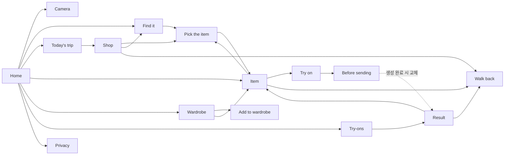

# Street Fitting 기능 명세서

작성일: 2026년 11월 4일
상태: 프로토타입 기준 초안

| 기준 문서 | 역할 |
| --- | --- |
| [prompts/street-fitting-mvp.md](prompts/street-fitting-mvp.md) | 원래 기획 |
| [street-fitting-research.md](street-fitting-research.md) 9장 | 확정한 MVP 범위(11월 3일) |
| [prototype/](prototype/) | 이 명세의 화면과 동작을 클릭으로 확인하는 프로토타입 |

이 문서는 확정한 MVP 범위를 기능 단위로 나누고, 각 기능을 프로토타입에서 어떻게 구현했는지 적는다. 프로토타입에는 실제 기능을 연결하지 않았으므로, 각 기능에서 **프로토타입 동작**과 **실제 구현**을 나눠 적는다. 화면 문구는 6차 합의대로 영어이며, 앱에 표시되는 그대로 따옴표로 적는다.

## 1. 전제

- **대상:** Android 스마트폰 앱이다. 대상 사용자는 영어 사용자이며, UI와 에이전트 질의 모두 영어다.
- **AI 모델:** Meta가 제공하는 모델만 쓴다. 서버 API로는 Muse Spark 1.3, SAM 3.1, Muse Image, Muse Voice Transcribe를 쓰고, 기기 안(ONNX)에서는 EdgeTAM과 PE-Core를 쓴다.
- **서버:** 중계 서버를 둔다. 중계 서버는 키를 보관하고 요청을 전달하기만 하며, 요청 내용은 저장하지 않는다.
- **본인 사진:** 얼굴과 머리를 뺀 편집본만 기기 밖으로 나간다. 원본 얼굴은 기기에서 결과에 다시 합성한다.
- **입력:** 실제 메타글래스가 없으므로 휴대폰 카메라로 촬영한다. 쇼핑 중 영상 녹화는 하지 않고 사진만 찍는다(5차 합의).

## 2. 화면 구조

바텀 탭은 없다. 홈이 스택의 바닥이고, 다른 화면은 모두 홈에서 출발해 한 단계씩 쌓인다.

- **화면 전환:** 새 화면은 오른쪽에서 밀려 들어오고, 아래 화면은 왼쪽으로 조금 밀리며 어두워진다.
- **뒤로 가기:** 상단 바의 화살표를 누르거나 Android 뒤로 가기를 쓰면 한 단계 돌아간다. 프로토타입에서는 `Esc`가 뒤로 가기다.
- **확인 시트:** 확인이 필요한 선택은 화면을 바꾸지 않고 바텀 시트로 띄운다. 시트 바깥을 누르면 닫힌다.

| 화면 | 프로토타입 경로 이름 | 들어오는 곳 | 관련 기능 |
| --- | --- | --- | --- |
| Home | `home` | 앱 시작 | F-01, F-09, F-10, F-14, F-16 |
| Camera | `capture` | 홈의 "Take photo" | F-02, F-03, F-04 |
| Today's trip | `trip` | 홈의 "See trip" | F-05 |
| Shop | `visit` | 홈 가게 목록, 동선 카드 | F-05 |
| Find it | `ask` | 홈 검색창, "Find another", 가게 화면 | F-06, F-07 |
| Pick the item | `pick` (`mode: shop`) | 검색 결과, 가게 사진, "Original photo" | F-08 |
| Add to wardrobe | `pick` (`mode: wardrobe`) | 옷장의 "Add a piece" | F-10 |
| Item | `item` | 후보 선택, 저장한 옷, 옷장, 결과 화면의 옷 목록 | F-09 |
| Try on | `outfit` | 옷 상세의 "Try it on", 결과의 "Change pieces" | F-11 |
| Before sending | `send` | "Continue" | F-12 |
| Your look | `result` | 생성 완료, 피팅 기록 | F-13 |
| Try-ons | `results` | 홈 | F-14 |
| Walk back | `walk` | 옷 상세, 가게 화면, 결과 화면 | F-15 |
| Wardrobe | `wardrobe` | 홈 | F-10 |
| Privacy | `privacy` | 홈 오른쪽 위 방패 아이콘 | F-16 |

생성이 끝나면 "Before sending" 화면은 스택에서 빠지고 그 자리에 결과 화면이 들어간다. 그래서 결과 화면에서 뒤로 가면 전송 확인을 다시 보지 않고 옷 조합 화면으로 돌아간다.

## 3. 기능 명세

우선순위는 9장 범위를 따른다. P0는 MVP에 필수인 기능이고, P1은 넣으면 좋은 기능이다. 프로토타입에만 있는 보조 화면은 "보조"로 표시한다.

### F-01 쇼핑 모드

- **우선순위:** P0
- **화면:** 홈 상단 카드, 종료 확인 시트
- **목적:** 쇼핑하는 동안 위치를 기록해 사진과 가게 위치를 연결한다.

| 상태 | 화면 | 동작 |
| --- | --- | --- |
| 꺼짐 | 제목 "Shopping mode", 설명 "Snap anything you like. We remember which shop it was in, so you can find it and walk back later.", 버튼 "Start shopping" | 버튼을 누르면 기록이 시작되고, 토스트 "Shopping mode on · recording your location"이 뜬다 |
| 기록 중 | 어두운 카드에 배지 "Recording", 경과 시간("N min"), 현재 가게("Shop N"), "N photos today · location on while this is on", 버튼 "Take photo" / "End" | "Take photo"는 카메라를 연다. "End"는 종료 확인 시트를 연다 |
| 종료 확인 | 시트 "End shopping mode?" 본문 "N shops, N photos. Your step-by-step location trail is deleted now. Each shop's spot and its photos stay on this phone.", 버튼 "Keep going" / "End" | "End"를 누르면 기록이 멈추고, 토스트 "Trail deleted · shop spots kept"가 뜬다 |

- **실제 구현**
  - 쇼핑 모드는 앱 화면의 버튼으로만 시작한다. 앱을 보고 있을 때 시작해야 백그라운드 위치 권한 없이 기록을 이어갈 수 있기 때문이다.
  - 위치는 포그라운드 서비스(`FOREGROUND_SERVICE_LOCATION`)와 FusedLocation으로 연속 기록하고, 기록 중에는 알림을 띄운다.
  - 쇼핑 모드가 끝나면 가게 방문 구간과 사진 위치만 남기고, 원본 위치 기록은 지운다.
- **프로토타입**
  - 위치를 실제로 기록하지 않는다. 경과 시간은 4초마다 1분씩 올라가는 가짜 시계다.
  - 기록 중 알림은 표시하지 않는다.
  - 처음 상태는 "꺼짐"이고, 오늘 이미 3곳 8장을 기록한 것으로 시작한다.

### F-02 옷 사진 촬영

- **우선순위:** P0
- **화면:** Camera(전체 화면이 어두운 카메라)
- **화면 구성**
  - **상단:** 뒤로 가기 버튼과 상태 칩. 칩에는 기록 표시 점, "Shop N · N new"(이번에 찍은 장수), 위치 정확도 "±12 m"가 들어간다.
  - **하단:** 마지막 사진 썸네일, 셔터, "New shop" 버튼.
- **동작**
  - 셔터를 누르면 화면이 하얗게 번쩍인다. 썸네일은 방금 찍은 사진으로 바뀌고, 사진 수는 1 늘어난다.
  - 사진마다 촬영 시각과 위치 태그가 붙는다.
- **실제 구현**
  - 촬영은 CameraX로 한다. 에뮬레이터에서는 이미지 파일을 카메라 입력으로 넣는다.
  - 위치는 촬영 시각과 위치 기록을 맞춰 붙인다.
- **프로토타입**
  - 샘플 사진 3장(옷걸이, 셔츠, 재킷)을 차례로 뷰파인더에 띄운다.
  - 저장했다는 표시는 토스트 대신 칩의 "N new"와 썸네일로 보여 준다.

### F-03 가게 방문 구분과 외관 사진

- **우선순위:** P0
- **화면:** Camera의 "New shop" 시트
- **동작**
  1. "New shop"을 누르면 시트 "In a new shop?"이 열린다. 본문은 "Take one photo of the shop front. Market stalls sit close together, and this is what helps you spot the right one when you walk back."이다.
  2. "Take storefront photo"를 누르면 외관 촬영 모드가 된다. 칩은 "New shop · storefront"로 바뀌고, 안내 "Fit the whole shop front in the frame"이 뜨며, 셔터가 노란색으로 바뀐다. 이 모드에서는 "New shop" 버튼이 비활성화된다.
  3. 외관을 찍으면 가게 번호가 1 늘고, 외관 묘사 카드(F-04)가 뜬다.
  4. "Skip"을 누르면 외관 사진 없이 가게 번호만 늘고, 토스트 "Shop N started · no storefront"가 뜬다.
- **실제 구현**
  - 모델 없이 계산한다. 사진을 연달아 찍은 묶음과 묶음 사이 이동 거리로 가게를 나눈다(예: 마지막 사진에서 15 m 이상 이동하면 새 가게 후보 [추론]).
  - 새 가게로 판단되면 외관 사진 촬영을 먼저 안내한다. "New shop"은 사용자가 직접 나누는 수단이다.
- **프로토타입**
  - "New shop" 버튼으로 직접 나누는 흐름만 있다. 자동 판단은 없다.

### F-04 외관 사진 자동 묘사

- **우선순위:** P0
- **화면:** Camera의 알림 카드. 묘사 결과는 동선, 가게, 옷 상세, 도착 카드에도 쓰인다.
- **동작**
  1. 외관을 찍으면 카드 "Shop N started"가 뜬다.
  2. 카드에 진행 표시 "Describing the storefront…"가 나온다.
  3. 묘사가 끝나면 짧은 영어 설명(예: "Two-tone house, clothes hung along the balcony")으로 바뀌고 "OK" 버튼이 생긴다.
- **실제 구현**
  - 외관 사진을 중계 서버를 거쳐 Muse Spark 1.3 Standard로 보내 설명을 만든다.
  - 설명은 기기에 저장하고, 에이전트가 가게를 좁히는 데 쓴다.
- **프로토타입**
  - 1.8초 뒤 고정된 문장을 보여 준다. 외관 사진도 샘플 한 장을 재사용한다.

### F-05 오늘 동선과 가게 상세

- **우선순위:** P0. 가게 구분 결과와 외관 사진을 보여 주는 화면이다.
- **홈 목록:** "Today · 3 shops" 아래에 가게마다 외관 썸네일, "Shop N", 방문 시각, "N photos · 외관 설명"을 한 줄씩 보여 준다.
- **Today's trip**
  - 부제는 "1:42–3:02 PM · 3 shops"다.
  - 방문 순서 번호가 세로 선으로 이어진다. 카드마다 외관 사진, 가게 이름, 시각, 외관 설명, 사진 썸네일이 들어간다.
  - 맨 아래 안내는 "Your location trail was deleted when shopping mode ended. Only each shop's spot is kept."다.
- **Shop**
  - 큰 외관 사진과 설명이 있고, "Photos" 목록이 이어진다. 목록 각 행은 사진 속 옷 후보 이름 두 개와 "시각 · tap to pick an item"이다.
  - 사진을 누르면 후보 선택(F-08)으로 간다.
  - 하단 버튼은 "Find it"(F-06)과 "Walk back · N min"(F-15)이다.
- **가게 구분 기준:** 동 이름이나 지명은 쓰지 않는다. 방문 순서, 시간, 외관 사진, 외관 설명으로 가게를 구분한다(6차 합의).

### F-06 에이전트 사진 검색

- **우선순위:** P0
- **화면:** Find it
- **입력 전**
  - 예시 질의 3개를 보여 준다: "the blue puffer at the outdoor stall", "red dress from the second shop", "gray blazer about 20 min ago".
  - 안내 문구는 "Your words and a short summary of today's shops are sent to find the photo. Photos of you are never part of this."이다.
  - 하단 입력창의 자리표시 문구는 "e.g. the jacket at the blue tarp stall"이다. 입력창 옆에 마이크 버튼(F-07)과 보내기 버튼이 있다.
- **질의 후**
  1. 질의가 오른쪽 말풍선으로 올라간다.
  2. 진행 단계 4개가 하나씩 나타나며, 진행 중에는 원이 돌고 끝나면 체크로 바뀐다.

     | 단계 | 표시 |
     | --- | --- |
     | 1 | "Read today's trip" · "3 shops, 8 photos, 1:42–3:02 PM" |
     | 2 | "Narrowed to Shop N" · 시각과 외관 설명 |
     | 3 | "Searched its photos" · "N close matches for '개념'" |
     | 4 | "Outlined the items" · "Pick the one you meant" |

  3. 결과 사진 카드가 나타난다. 첫 카드는 "Best match"로 테두리를 강조하고, 나머지는 "Match N"이다. 각 카드에는 1순위 후보 윤곽, 가게, 시각, 후보 수를 보여 준다.
  4. 카드를 누르면 후보 선택(F-08)으로 간다.
- **실제 구현**
  - Muse Spark 1.3이 도구를 호출해 방문 순서, 시간, 외관 묘사로 가게를 좁힌다.
  - `find_photos`로 사진을 찾는다. 사진 색인은 기기의 PE-Core 이미지 벡터를 쓰고, 검색 문구는 중계 서버의 PE-Core 텍스트 타워로 임베딩한다.
  - 상위 사진 1~3장을 SAM 3.1에 보내 옷 후보를 받는다.
  - 질의 한 번에 Spark 호출은 최대 4회, SAM에 보내는 사진은 최대 3장이다.
- **실패 시 대안(10장):** 질의를 잘못 해석하면 시간, 가게, 옷 종류 칩으로 범위를 직접 고르게 한다. 검색 정확도가 낮으면 해당 방문의 사진을 모두 보여 준다.
- **프로토타입**
  - 질의에 든 단어로 결과를 고른다.

    | 질의에 든 단어 | 결과 |
    | --- | --- |
    | dress, red | Shop 2의 빨간 드레스 |
    | blazer, gray, warehouse | Shop 3 |
    | shirt, stripe | Shop 1 |
    | 그 밖 | Shop 2의 파란 패딩 |

  - 단계 표시는 0.7초, 이후 0.9초 간격으로 넘어간다.

### F-07 음성 질의

- **우선순위:** P1
- **화면:** Find it의 마이크 버튼
- **동작**
  1. 마이크를 누르면 버튼이 채워지고 입력창에 "Listening…"이 뜬다.
  2. 전사가 끝나면 입력창에 문장이 채워지고, 토스트 "Transcribed · edit it if needed"가 뜬다.
  3. 사용자는 문장을 고친 뒤 보낸다. 전사 결과를 바로 보내지는 않는다.
- **실제 구현:** 마이크를 누른 5~15초 구간만 Muse Voice Transcribe로 보낸다.
- **프로토타입:** 1.6초 뒤 첫 번째 예시 질의를 채운다.

### F-08 옷 후보 선택

- **우선순위:** P0
- **화면:** Pick the item
- **화면 구성**
  - **사진:** 원래 비율 그대로 보여 주고, 후보마다 번호가 붙은 흰 윤곽을 겹친다. 선택한 후보 바깥은 어둡게 하고, 나머지 후보는 점선으로 표시한다.
  - **후보 목록:** "Found N items, best first" 아래에 후보마다 번호, 잘라낸 썸네일, 이름, 예측 점수(%)를 보여 준다. 목록이나 사진 윤곽을 누르면 선택이 바뀐다.
  - **하단 버튼:** "Not here? Tap it" / "Use this item".
- **탭 지정 모드**
  1. "Not here? Tap it"을 누르면 후보 윤곽이 사라지고 안내 "Tap the item in the photo"가 뜬다.
  2. 사진을 탭하면 탭 지점에 점이 찍히고, 그 지점을 중심으로 영역 3개가 생긴다. 목록 제목은 "Which area?"로 바뀐다.
  3. 영역은 "Small area", "Medium area", "Large area"이며 점수 순으로 정렬된다. 점수가 가장 높은 영역이 먼저 선택된다.
  4. "Show matches"를 누르면 원래 후보로 돌아간다.
- **선택 확정**
  - "Use this item"을 누르면 저장한 옷에 추가되고 옷 상세(F-09)로 간다. 선택한 것이 없으면 버튼이 비활성화된다.
  - 탭으로 고른 영역에는 탭 지점을 포함하는 후보의 이름을 붙인다. 그런 후보가 없으면 질의 개념을 쓰고, 그것도 없으면 "Picked item"을 쓴다.
- **실제 구현**
  - 후보는 SAM 3.1이 돌려준다. 탭 영역은 기기의 EdgeTAM이 돌려주는 마스크 3개다.
  - 모든 후보는 점수 순으로 보여 주고 사용자가 고른다. PE-Core로 후보를 걸러 내지는 않는다. 7.1절 실측에서 정답 마스크까지 걸러졌기 때문이다.
  - 실제 마스크는 박스가 아니라 옷 윤곽선이다.
- **프로토타입**
  - 후보는 사진마다 미리 정한 박스다.
  - 탭 영역은 탭 지점 중심의 정사각형 계열 박스이고, 점수는 71/86/64%로 고정이다.

### F-09 저장한 옷과 옷 상세

- **우선순위:** P0. 검색 결과를 피팅과 길 안내로 넘기는 연결 화면이다.
- **홈 "Saved"**
  - 저장한 옷을 잘라낸 타일로 가로로 나열하고, 개수를 함께 보여 준다.
  - 맨 끝 타일 "Find another"를 누르면 검색(F-06)으로 간다.
  - 같은 옷은 두 번 저장되지 않는다.
- **Item(가게 옷)**
  - 제목은 옷 이름, 부제는 "Shop N · 시각"이다.
  - 흰 바탕에 큰 옷 이미지를 보여 준다.
  - 가게 카드에는 외관 사진, 가게 이름, 외관 설명, 칩 "N m · N min walk", 칩 "Original photo"(후보 선택 화면으로 이동)가 들어간다.
  - 하단 버튼은 "Walk back"(F-15)과 "Try it on"(F-11)이다.
- **Item(옷장 옷):** 부제가 "In your wardrobe"이고 가게 카드가 없다. 하단 버튼은 "Try it on"만 있다.
- **프로토타입:** 처음 상태로 빨간 드레스 1벌이 저장돼 있다.

### F-10 옷장

- **우선순위:** P0
- **Wardrobe**
  - 부제는 "N pieces you own"이다. 보유 옷을 2열 타일로 보여 준다.
  - 안내 문구는 "Mix these with what you saved to see them together. Only the cut-out piece is ever sent, never the whole photo."이다.
- **추가**
  1. "Add a piece"를 누르면 시트 "Add a piece"가 열린다. 본문은 "Lay it flat or hang it up. You'll tap it to cut it out."이고, 선택지는 "Take a photo"와 "Choose from gallery"다.
  2. 고르면 "Add to wardrobe" 화면이 열린다. 처음부터 탭 지정 모드(F-08과 같은 영역 3개)다.
  3. "Add to wardrobe"를 누르면 옷장 화면으로 돌아가고, 토스트 "Added to your wardrobe"가 뜬다.
- **실제 구현**
  - EdgeTAM 탭으로 옷을 분리한다.
  - 옷장 원본은 기기에만 둔다. 피팅할 때는 잘라낸 옷 이미지만 보낸다.
  - 보유 옷 유사도 매칭은 MVP 범위에서 제외했다.
- **프로토타입**
  - 처음 옷장에는 청바지와 플랫슈즈가 있다.
  - 추가 사진은 촬영과 갤러리 모두 같은 샘플 재킷 사진이다.

### F-11 피팅할 옷 조합 선택

- **우선순위:** P0
- **화면:** Try on(부제 "Pick what to wear together")
- **화면 구성**
  - **내 사진 카드:** "Your photo", "Full-body, taken Oct 30. Kept on this phone.", 버튼 "Change".
  - **"Wearing":** 고른 옷을 가로로 나열한다. 각 타일에 ×가 있고, 누르면 빠진다. 고른 옷이 없으면 "Nothing yet. Pick from below."를 보여 준다.
  - **"Saved from shops"와 "Your wardrobe":** 3열 타일이고, 누를 때마다 선택이 바뀐다. 선택하면 테두리가 강조되고 체크가 표시된다.
  - **하단:** "N of 9 pieces"와 "Continue". 고른 옷이 없으면 "Continue"가 비활성화된다.
- **규칙**
  - 옷 상세에서 들어오면 그 옷이 자동으로 선택돼 있다.
  - 가게 옷끼리, 가게 옷과 보유 옷 조합을 모두 허용한다. 최대 9벌이며, 넘기면 토스트 "Up to 9 pieces at once"가 뜬다.
- **내 사진 변경:** "Change"를 누르면 시트가 열린다. 촬영 자세를 안내하고("Stand facing the camera, arms a little away from your body…"), 선택지는 "Take a photo"와 "Choose from gallery"다.
- **실제 구현**
  - 본인 사진은 앱 전용 저장소에만 두고 갤러리에 등록하지 않는다.
  - 본인 사진을 다루는 코드 경로에는 네트워크 호출을 두지 않는다.
- **프로토타입**
  - 내 사진은 실루엣 자리표시다.
  - "Change"의 두 선택지는 토스트 "Prototype: … not connected"만 띄운다.

### F-12 전송 확인과 피팅 생성

- **우선순위:** P0
- **화면:** Before sending(부제 "This is exactly what leaves your phone")
- **화면 구성**
  - **전송본 미리보기:** 머리 부분을 가리고 자물쇠를 표시한 내 사진에 라벨 "Face and hair held back"을 붙인다. 옆에 보낼 옷 조각 목록을 둔다.
  - **데이터 경계 3행**

    | 행 | 설명 |
    | --- | --- |
    | "Stays on this phone" | Your face and hair, and the original photo |
    | "Sent once, not stored" | The photo above and the pieces, to Meta's image model through our relay |
    | "Put back on this phone" | Your face goes back onto the result here |

- **생성**
  - "Generate"를 누르면 같은 버튼 안에서 글자가 단계별로 바뀐다: "Sending without your face…" → "Generating the look…" → "Putting your face back…".
  - 진행 중에는 버튼을 다시 누를 수 없다.
  - 완료되면 결과(F-13)가 이 화면을 대신한다.
- **실제 구현**
  - 기기에서 얼굴과 머리 영역을 뺀다. 마스킹은 EdgeTAM이 보조한다.
  - 편집본과 옷 이미지를 중계 서버를 거쳐 Muse Image로 보낸다. 본인 사진 1장과 옷 최대 9장이다.
  - 결과가 오면 기기에서 원본 얼굴을 다시 합성한다.
- **실패 시 대안(10장):** 피팅 품질이나 얼굴 재합성이 기준에 못 미치면 자르기·덮기 방식을 바꾼다. 그래도 안 되면 얼굴 없는 결과를 보여 준다.
- **프로토타입**
  - 각 단계는 1.0초, 2.2초, 1.0초 뒤 넘어간다.
  - 가린 사진은 실루엣 위 빗금 상자다.

### F-13 피팅 결과

- **우선순위:** P0
- **화면:** Your look(부제 "N pieces · Just now")
- **화면 구성**
  - 결과 이미지 아래에 "Look" / "Original" 전환이 있다.
  - "Wearing" 목록은 옷마다 썸네일, 이름, 출처("Shop N · N m" 또는 "Your wardrobe")를 보여 준다. 누르면 옷 상세로 간다.
  - 안내 문구는 "Only shown in this app. Sharing comes later."이다.
- **하단 버튼**
  - "Change pieces": 옷 조합 화면으로 돌아간다. 피팅 기록에서 들어왔으면 새로 연다.
  - "Walk to Shop N": 결과에 든 가게 옷 중 첫 번째 옷의 가게로 안내한다. 옷이 모두 옷장 옷이면 버튼이 없다.
- **실제 구현**
  - 결과는 앱 안에서만 보여 준다.
  - 공유는 Muse Image 결과의 워터마크와 메타데이터를 얼굴 재합성 후에도 보존하는 방법을 확인한 뒤에 연다.
- **프로토타입:** 결과 이미지는 실루엣 위에 옷 조각을 부위별(상의, 하의, 신발, 원피스)로 얹은 자리표시다. 화면에 "Generated look (placeholder)"라고 적혀 있다.

### F-14 피팅 기록

- **우선순위:** 보조. 9장 범위에는 없고, 결과를 다시 찾는 진입점으로 추가했다.
- **화면:** 홈의 "Try-ons" 행. 부제는 개수와 "kept on this phone"이고, 기록이 없으면 "No looks yet"이다.
- **Try-ons**
  - 결과를 2열 카드로 보여 준다. 누르면 결과 화면(F-13)으로 간다.
  - 기록이 없으면 "No looks yet / Open something you saved and tap Try it on."을 보여 준다.
- **저장 위치:** 결과는 기기에만 보관한다.

### F-15 매장까지 도보 길 안내

- **우선순위:** P0
- **화면:** Walk back(전체 화면 지도)
- **화면 구성**
  - **지도:** 경로선, 지나온 구간(점선), 현재 위치 점, 목적지 핀과 그 주변 반경.
  - **상단 안내 카드:** 방향 아이콘, 다음 안내까지 거리, 안내 문장(예: "Turn left at the subway exit 3").
  - **하단 카드:** 외관 썸네일, "Shop N", "남은 거리 · 시간 · where you took the photo", 버튼 "End".
- **경로 이탈:** 상단 카드가 갈색으로 바뀌고 "Off route. Finding a new way…"가 뜬다. 재탐색이 끝나면 원래 안내로 돌아간다.
- **도착**
  - 하단이 도착 카드로 바뀐다: "You're at Shop N", "Look for this shop front. Stalls here sit close together, so trust the photo over the pin.", 큰 외관 사진, 외관 설명, 버튼 "Done".
  - 시장의 GPS 오차(10~20 m)가 가게 간격보다 크기 때문에, 도착 판단은 외관 사진으로 사용자가 확인한다.
- **실제 구현**
  - 지도는 MapLibre와 OpenFreeMap 타일, 도보 경로는 FOSSGIS OSRM foot을 쓴다(4차 합의).
  - 목적지는 사진을 찍은 위치다. 길 안내를 누를 때만 출발·도착 좌표를 경로 서버로 보낸다.
  - 음성 안내, 백그라운드 안내, 실내 길 안내는 제외한다.
- **프로토타입**
  - 지도와 경로는 직접 그린 그림이다. 4단계 안내와 남은 거리("410 m · 6 min" 등)는 고정값이다.
  - 화면 오른쪽 위에 점선 테두리의 "Demo" 묶음이 있다. "Walk a step"은 한 단계 진행하고, "Go off route"는 1.4초 동안 재탐색을 보여 준다.
  - 이 "Demo" 묶음은 시연용이며 제품 UI가 아니다.

### F-16 개인정보 안내

- **우선순위:** 보조. 9장의 데이터 경계를 사용자에게 보여 주는 화면이다.
- **화면:** Privacy(부제 "What stays and what leaves")
- **"Stays on this phone"**
  - Photos of you
  - Your location trail
  - Shop photos and the search index
  - Try-on results
- **"Leaves once, not stored"**
  - What you ask
  - Up to 3 shop photos
  - Storefront photos
  - Your photo without face or hair
  - Start and end of a walk
- **안내 문구:** "Sent through our relay to Meta's models. The relay keeps nothing."

### F-17 공통 동작

- **토스트:** 화면 아래쪽에 2.6초 동안 떴다가 사라진다. 바텀 시트가 열리면 바로 사라져 시트 문구를 가리지 않는다.
- **바텀 시트:** 열 때와 닫을 때 모두 미끄러지며 움직인다. 뒤의 반투명 배경을 누르면 닫힌다.
- **버튼:** 주요 버튼은 높이 48 px의 둥근 버튼이다. 한 화면에서 채워진 주요 버튼은 하나만 둔다.
- **상태 표시줄:** 카메라 화면에서만 밝은 글자로 바뀐다.

## 4. 데이터 모델

`prototype/src/data.ts`와 `prototype/src/state.tsx`의 구조를 기준으로 한다. 실제 구현에서도 같은 단위를 쓰는 것을 제안한다 [추론].

| 단위 | 필드 | 설명 |
| --- | --- | --- |
| 가게 방문 `Shop` | `n`, `time`, `storefront`, `description`, 사진 위치 | 쇼핑 모드가 끝난 뒤에도 남는 단위. 원본 위치 기록 대신 남긴다 |
| 사진 `Photo` | `id`, `src`, `w`, `h`, `shop`, `time`, `candidates` | 촬영 시각과 위치 태그가 붙은 옷 사진. 실제로는 PE-Core 임베딩도 갖는다 |
| 후보 `Candidate` | `id`, `label`, `score`, `box` | SAM 3.1 또는 EdgeTAM 결과. 실제로는 박스 대신 마스크 |
| 옷 조각 `Piece` | `id`, `label`, 이미지·영역, `from`(shop/wardrobe), `shop`, `photoId` | 저장한 옷과 옷장 옷의 공통 단위. 피팅과 길 안내가 이 단위를 받는다 |
| 피팅 결과 `Result` | `id`, `pieces`, `at` | 기기에만 보관 |
| 쇼핑 상태 `Shopping` | `on`, `minutes`, `shop`, `photos`, `captured` | 기록 중 여부와 현재 가게 번호 |
| 옷 조합 `outfit` | 옷 조각 id 목록(최대 9) | 피팅 화면 사이에서 유지 |

## 5. 데이터 경계

9장 표를 기능 단위로 다시 정리했다.

| 위치 | 데이터 | 관련 기능 |
| --- | --- | --- |
| 기기 안에만 | 옷 사진 원본, 원본 본인 사진(얼굴 포함), 쇼핑 모드 동안의 원본 위치 기록, 가게 방문 구간, 사진 임베딩, 옷장 원본, 얼굴 재합성 결과 | F-01, F-02, F-10, F-11, F-13 |
| 중계 서버 → Meta | 질의 텍스트와 방문 요약 | F-06 |
| 중계 서버 → Meta | 가게 외관 사진 | F-04 |
| 중계 서버 → Meta | 선택된 옷 사진 1~3장 | F-06, F-08 |
| 중계 서버 → Meta | 얼굴을 뺀 본인 사진과 옷 이미지 | F-12 |
| 중계 서버 → Meta | 짧은 음성(P1) | F-07 |
| 중계 서버 안에서만 | 검색 문구의 PE-Core 텍스트 임베딩 | F-06 |
| 중계 서버 → 경로 서버 | 출발·도착 좌표 | F-15 |
| 앱 → 지도 타일 서버 | 화면에 보이는 지도 영역 | F-15 |

## 6. 기획과 프로토타입의 차이

**9장 범위에 있지만 프로토타입에 화면이 없는 것**

| 기능 | 9장 내용 | 비고 |
| --- | --- | --- |
| 자동 가게 구분 | 사진 묶음과 이동 거리로 새 가게를 판단하고 외관 촬영을 안내 | 수동 "New shop" 흐름만 구현 |
| 사진 가져오기 | 갤러리에서 쇼핑 사진을 가져오고 촬영 시각으로 위치를 붙임. 쇼핑 모드 밖에서 찍은 사진은 지도에서 위치 지정 | 화면 없음 |
| 목적지 핀 옮기기 | 길 안내 목적지를 사용자가 옮길 수 있음 | 화면 없음 |
| 기록 중 알림 | 포그라운드 서비스 알림 | 시스템 알림이라 표시하지 않음 |
| 중계 서버 | 키 보관, 앱 인증, 쿼터·비용 상한, 무저장 | 서버 기능이라 UI 없음 |
| 기기 안 사진 색인 | PE-Core, 사진당 1회 | 백그라운드 처리라 UI 없음 |
| Mock 글래스 캡처(P1) | DAT Mock Device Kit | 화면 없음 |

**9장 범위에 없지만 프로토타입에 넣은 것**

| 요소 | 이유 |
| --- | --- |
| 피팅 기록 목록(F-14) | 홈에서 이전 결과로 돌아갈 진입점 |
| 개인정보 화면(F-16) | 데이터 경계를 사용자에게 설명 |
| 옷 상세의 "Original photo" | 다른 후보를 다시 고르는 경로 |
| 결과 화면의 Look/Original 전환 | 생성 전후 비교 |
| 길 안내 "Demo" 묶음 | 시연용이며 제품 기능이 아님 |

## 7. 미정·확인 필요

- **새 가게 안내 방식:** 자동 판단 시 외관 촬영 안내를 시트로 띄울지, 카메라 위 배너로 띄울지 정해야 한다. 프로토타입은 시트만 있다.
- **사진 가져오기 진입점:** 홈, 가게 화면, 카메라 중 어디에 둘지 정해야 한다.
- **결과 화면의 대상 가게:** 결과에 가게 옷이 여러 벌이면 현재는 첫 번째 옷의 가게만 안내한다. 가게를 고르게 할지 정해야 한다.
- **피팅 결과 보관:** 보관 기간과 삭제 UI가 없다.
- **처리 지연:** API 지연을 측정한 뒤(10장) 진행 단계 문구와 예상 시간 표시를 정한다.
- **질의 해석 실패 시 대안:** 시간·가게·옷 종류 칩으로 범위를 고르는 화면(10장)은 설계하지 않았다.
